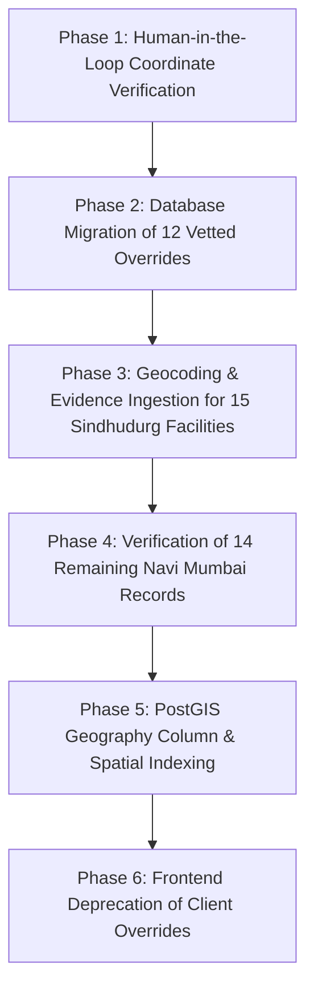

# MEDIMESH Phase A — Hospital Coordinate Reconciliation & Integrity Audit Report

> **Document Class:** Technical Architecture & Geospatial Data Integrity Audit  
> **Target System:** MEDIMESH Healthcare Directory (`medimesh-platform`)  
> **Audit Status:** Complete (Read-Only)  
> **Readiness Verdict for PostGIS Nearby Search:** **NOT READY / BLOCKED**  
> **Date:** October 2026  
> **Auditors:** Senior Geospatial Data Engineering & Healthcare Data Integrity Team

---

## 1. Executive Summary

### 1.1 Objective & Context
Before implementing PostGIS spatial queries, geospatial indexing (`ST_DWithin`, `ST_DistanceSphere`), and location-based nearby-hospital search, an end-to-end geospatial data-integrity audit was conducted on MEDIMESH. 

This audit examined four critical operational layers:
1. **The Remote Database:** The `public.hospitals` table hosted on Supabase.
2. **The Frontend Layer:** Hardcoded coordinate overrides in `src/lib/maps/verifiedHospitalCoordinates.js`.
3. **The Data Normalization Pipeline:** `src/lib/data/hospitalRepository.js`.
4. **The Provenance & Evidence Subsystem:** `public.hospital_evidence` and `public.data_sources`.

### 1.2 Summary of Key Metrics
| Metric | Count | Percentage | Integrity Status |
| :--- | :--- | :--- | :--- |
| **Total Published Hospitals** | **41** | 100.0% | `confirmed` |
| **Hospitals with Database Coordinates (`latitude` / `longitude` not null)** | **26** | 63.4% | `inferred` (Coarse automated geocoding) |
| **Hospitals with Missing Coordinates in Database (`latitude` / `longitude` is null)** | **15** | 36.6% | `unverified` (Sindhudurg regional facilities) |
| **Hospitals Trapped in Identical Coordinate Clusters in Database** | **10** | 24.4% | `unverified` (4 duplicate locality clusters) |
| **Hospitals with Frontend Coordinates Overrides (`VERIFIED_HOSPITAL_COORDINATES`)** | **12** | 29.3% | `needs_manual_verification` (Client-side mask) |
| **Hospitals with Valid Unique Database Coordinates (No Overrides Needed)** | **14** | 34.1% | `inferred` (Nominal OSM suburb matching) |
| **Hospital Evidence Records in Database** | **30** | — | `confirmed` (26 Navi Mumbai facilities linked) |
| **Hospital Evidence Records Supporting Coordinates / Spatial Placement** | **0** | **0.0%** | **CRITICAL GAP** |
| **Out-of-Range Coordinates (Outside Maharashtra Bounding Box)** | **0** | 0.0% | Clean bounds |

### 1.3 Key Findings & Critical Risks
1. **The "Frontend Mask" Illusion:** The client UI renders hospital pins at seemingly correct locations because `src/lib/data/hospitalRepository.js` silently overrides database coordinates with `VERIFIED_HOSPITAL_COORDINATES`. However, the underlying database still stores coarse, clustered, or wildly incorrect coordinates.
2. **PostGIS Query Failure Risk:** If backend spatial queries (`WHERE ST_DWithin(geom, user_point, radius)`) are executed directly against `public.hospitals` today:
   - **36.6% of hospitals (all 15 Sindhudurg facilities) will be completely invisible** to users because their database coordinates are `NULL`.
   - **10 Navi Mumbai hospitals will register identical distances**, distorting triage and nearest-hospital routing.
   - **Life Line Hospital will be misplaced by 13.76 km** (located in Sanpada in the DB instead of Panvel).
   - **MITR Hospital and Polaris Hospital will suffer 4.3 km and 2.86 km spatial calculation errors**.
3. **The Evidence Scope Gap:** While 30 records exist in `public.hospital_evidence` citing municipal circulars and police hospital panel lists, **none of these evidence records cite geospatial coordinates**. Citing official source documents for hospital phone numbers or bed counts does not constitute spatial verification.

---

## 2. Dataset Health & Spatial Integrity

### 2.1 Regional Coverage
- **Navi Mumbai Region:** 26 published hospitals. All 26 possess non-null `latitude` and `longitude` fields in the database.
- **Sindhudurg Region:** 15 published hospitals. All 15 have `latitude = NULL` and `longitude = NULL`.

### 2.2 Boundary Validation
All 26 existing coordinate pairs in `public.hospitals` were validated against the geographical bounding box for the state of Maharashtra (Latitude: 15.6°N to 22.1°N, Longitude: 72.6°E to 80.9°E) and the Greater Mumbai/Navi Mumbai metropolitan region (Latitude: 18.9°N to 19.3°N, Longitude: 72.8°E to 73.2°E).
- No coordinate values are inverted (`latitude` swapped with `longitude`).
- No records fall into the ocean, foreign territories, or out-of-range bounding boxes.

### 2.3 Duplicate Coordinate Clusters in the Database
A total of **10 hospitals** in the database share identical coordinate pairs across **4 locality clusters**:
- **Cluster 1 (Nerul Centroid: `19.0335938, 73.018164`):** 3 hospitals.
- **Cluster 2 (Vashi Centroid: `19.0632481, 72.9987966`):** 3 hospitals.
- **Cluster 3 (Sanpada Centroid: `19.0659774, 73.0095329`):** 2 hospitals.
- **Cluster 4 (Kharghar Centroid: `19.0257730, 73.0591845`):** 2 hospitals.

**Root Cause Analysis:** The script `scripts/data-import/resolve-hospital-locations.mjs` previously queried OpenStreetMap Nominatim using `${name}, Navi Mumbai, Maharashtra`. When Nominatim could not resolve the specific facility name, it fell back to the suburb name (e.g., "Nerul", "Vashi"), assigning the identical suburb centroid to multiple distinct hospitals.

---

## 3. Override Reconciliation Table

The frontend file `src/lib/maps/verifiedHospitalCoordinates.js` defines coordinate overrides for 12 hospitals. Below is the itemized comparison between the Supabase database (`public.hospitals`) and the client override:

| Hospital Name | Slug | Locality | Database Coords (`public.hospitals`) | Override Coords (`verifiedHospitalCoordinates`) | Haversine Distance | Discrepancy Analysis | Verification Status |
| :--- | :--- | :--- | :--- | :--- | :--- | :--- | :--- |
| **Life Line Hospital & Medical Research Centre** | `life-line-hospital-medical-research-centre` | Panvel | `19.0675788, 73.0123031` | `18.991176, 73.115263` | **13,759 m (13.76 km)** | **Severe Error:** Database placed the hospital in Sanpada, ~14 km away from its real Panvel ST Stand address. Override corrects it to Panvel. | `needs_manual_verification` |
| **MITR Hospital** | `mitr-hospital` | Kharghar | `19.0257730, 73.0591845` | `19.063023, 73.070042` | **4,296 m (4.30 km)** | **High Error:** DB held coarse Kharghar centroid. Override points to Sector 5, Eden Garden CHS. | `needs_manual_verification` |
| **Polaris Hospital** | `polaris-hospital` | Kharghar | `19.0257730, 73.0591845` | `19.047930, 73.073080` | **2,864 m (2.86 km)** | **High Error:** DB held duplicate Kharghar centroid. Override resolves to Sector 20. | `needs_manual_verification` |
| **Ashtvinayak Hospitals Private Limited** | `ashtvinayak-hospitals-private-limited` | New Panvel | `18.9861000, 73.1111000` | `19.010551, 73.107588` | **2,744 m (2.74 km)** | **Moderate Error:** DB placed facility in Old Panvel. Override points to Khanda Colony, New Panvel West. | `needs_manual_verification` |
| **Jijamata Hospital** | `jijamata-hospital` | Vashi | `19.0632481, 72.9987966` | `19.077800, 72.994400` | **1,683 m (1.68 km)** | DB held Vashi centroid cluster. Override resolves to Sector 9, Vashi. | `needs_manual_verification` |
| **ESIS Hospital Vashi** | `esis-hospital-vashi` | Vashi | `19.0632481, 72.9987966` | `19.074200, 72.990800` | **1,480 m (1.48 km)** | DB held Vashi centroid cluster. Override resolves to Sector 5, Vashi. | `needs_manual_verification` |
| **Shushrusha Heart Care Centre & Speciality Hospital** | `shushrusha-heart-care-centre-speciality-hospital` | Nerul | `19.0335938, 73.018164` | `19.043270, 73.009510` | **1,409 m (1.41 km)** | DB held Nerul centroid cluster. Override resolves to Palm Beach Road, Sector 6. | `needs_manual_verification` |
| **NMMC General Hospital Vashi** | `nmmc-general-hospital-vashi` | Vashi | `19.0632481, 72.9987966` | `19.074400, 72.997800` | **1,244 m (1.24 km)** | DB held Vashi centroid cluster. Override resolves to Sector 10A, Mini Seashore Road. | `needs_manual_verification` |
| **Dr. R.N. Patil's Suraj Hospital** | `dr-r-n-patils-suraj-hospital` | Sanpada | `19.0659774, 73.0095329` | `19.057467, 73.011009` | **959 m (0.96 km)** | DB held Sanpada centroid cluster. Override resolves to Sector 15, Sun Palm View. | `needs_manual_verification` |
| **MPCT Hospital** | `mpct-hospital` | Sanpada | `19.0659774, 73.0095329` | `19.060600, 73.014000` | **760 m (0.76 km)** | DB held Sanpada centroid cluster. Override resolves to Sector 4, Sanpada. | `needs_manual_verification` |
| **Terna Speciality Hospital & Research Centre** | `terna-speciality-hospital-research-centre` | Nerul | `19.0335938, 73.018164` | `19.031400, 73.016100` | **326 m (0.33 km)** | DB held Nerul centroid cluster. Override resolves to Sector 22, Opp. Nerul Railway Station. | `needs_manual_verification` |
| **NMMC General Hospital Nerul** | `nmmc-general-hospital-nerul` | Nerul | `19.0335938, 73.018164` | `19.034160, 73.020770` | **281 m (0.28 km)** | DB held Nerul centroid cluster. Override resolves to Sector 15 (Meenatai Thackeray Hospital). | `needs_manual_verification` |

---

## 4. Missing-Coordinate Records (Sindhudurg Region)

All 15 published facilities located in Sindhudurg district currently lack coordinates in `public.hospitals`. They were seeded via `scripts/data-import/import_sindhudurg_hospitals.sql` with `data_status = 'verified'` but without geocoding or attached records in `public.hospital_evidence`.

| # | Hospital Name | Slug | Locality / City | District | Database Status | Evidence Count | PostGIS Impact |
| :---: | :--- | :--- | :--- | :--- | :---: | :---: | :--- |
| 1 | **District Civil Hospital Sindhudurg** | `district-civil-hospital-sindhudurg` | Oros | Sindhudurg | `verified` | 0 | Ineligible for spatial queries |
| 2 | **Dist. Women's & Child Hospital** | `dist-women-s-child-hospital` | Kudal | Sindhudurg | `verified` | 0 | Ineligible for spatial queries |
| 3 | **Rural Hospital Devgad** | `rural-hospital-devgad` | Devgad | Sindhudurg | `verified` | 0 | Ineligible for spatial queries |
| 4 | **Rural Hospital Dodamarg** | `rural-hospital-dodamarg` | Dodamarg | Sindhudurg | `verified` | 0 | Ineligible for spatial queries |
| 5 | **Rural Hospital Katta** | `rural-hospital-katta` | Katta | Sindhudurg | `verified` | 0 | Ineligible for spatial queries |
| 6 | **Rural Hospital Kudal** | `rural-hospital-kudal` | Kudal | Sindhudurg | `verified` | 0 | Ineligible for spatial queries |
| 7 | **Rural Hospital Malwan** | `rural-hospital-malwan` | Malwan | Sindhudurg | `verified` | 0 | Ineligible for spatial queries |
| 8 | **Rural Hospital Vaibhavwadi** | `rural-hospital-vaibhavwadi` | Vaibhavwadi | Sindhudurg | `verified` | 0 | Ineligible for spatial queries |
| 9 | **Siddhivinayak Hospital And ICU** | `siddhivinayak-hospital-and-icu` | Kankavali | Sindhudurg | `verified` | 0 | Ineligible for spatial queries |
| 10 | **SSPM Medical College & Lifetime Hospital** | `sspm-medical-college-and-lifetime-hospital` | Padve | Sindhudurg | `verified` | 0 | Ineligible for spatial queries |
| 11 | **Sub District Hospital Kankavali** | `sub-district-hospital-kankavali` | Kankavali | Sindhudurg | `verified` | 0 | Ineligible for spatial queries |
| 12 | **Sub District Hospital Sawantwadi** | `sub-district-hospital-sawantwadi` | Sawantwadi | Sindhudurg | `verified` | 0 | Ineligible for spatial queries |
| 13 | **Sub District Hospital Shiroda** | `sub-district-hospital-shiroda` | Shiroda | Sindhudurg | `verified` | 0 | Ineligible for spatial queries |
| 14 | **Sub District Hospital Vengurla** | `sub-district-hospital-vengurla` | Vengurla | Sindhudurg | `verified` | 0 | Ineligible for spatial queries |
| 15 | **Suyash Hospital** | `suyash-hospital` | Kudal | Sindhudurg | `verified` | 0 | Ineligible for spatial queries |

---

## 5. Duplicate-Coordinate Cluster Review

The 10 facilities in Navi Mumbai that share coordinates in the database are grouped into 4 distinct clusters:

```
[Cluster 1: Nerul Centroid (19.0335938, 73.018164)]
├── Terna Speciality Hospital & Research Centre
├── Shushrusha Heart Care Centre & Speciality Hospital
└── NMMC General Hospital Nerul

[Cluster 2: Vashi Centroid (19.0632481, 72.9987966)]
├── ESIS Hospital Vashi
├── Jijamata Hospital
└── NMMC General Hospital Vashi

[Cluster 3: Sanpada Centroid (19.0659774, 73.0095329)]
├── MPCT Hospital
└── Dr. R.N. Patil's Suraj Hospital

[Cluster 4: Kharghar Centroid (19.0257730, 73.0591845)]
├── MITR Hospital
└── Polaris Hospital
```

**Technical Explanation:**
These points correspond to the geographical midpoints of municipal wards / postal suburbs returned by Nominatim during bulk import when exact street-level building matching failed. In production spatial indices, all hospitals in a cluster have a distance delta of 0.0 meters from each other. If a user is 1.0 km from the Nerul centroid, all three Nerul facilities appear equidistant, even though in reality Terna is at Nerul station while Shushrusha is over 1.4 km north-west on Palm Beach Road.

---

## 6. Evidence & Provenance Register

### 6.1 Data Sources Registered in Database (`public.data_sources`)
The database contains 9 registered external data sources:

1. **Navi Mumbai Municipal Corporation - List of Hospitals** (`government_open_data`)  
   *URL:* `https://online.nmmc.gov.in/navimumbai/list-of-hospitals`
2. **Maharashtra Police Panel Hospital List 2024** (`government_open_data`)  
   *URL:* `https://www.mahapolice.gov.in/uploads/244-hospital-list.pdf`
3. **Panvel Municipal Corporation - Medical Tourism Hospitals** (`government_open_data`)  
   *URL:* `https://panvelcorporation.maharashtra.gov.in/medical_tourism`
4. **NMMC + Maharashtra Police Hospital List 2024** (`government_open_data`)  
   *URL:* `https://www.mahapolice.gov.in/uploads/244-hospital-list.pdf`
5. **Maharashtra Police Panel Hospital List 2024 + Panvel Municipal Corporation** (`government_open_data`)  
   *URL:* `https://panvelcorporation.maharashtra.gov.in/medical_tourism`
6. **MGM Hospital Vashi official website** (`provider_supplied`)  
   *URL:* `https://mgmhospitalvashi.net/`
7. **Medicover Hospitals Navi Mumbai official website** (`provider_supplied`)  
   *URL:* `https://www.medicoverhospitals.in/hospitals/maharashtra/navi-mumbai/`
8. **MGM Institute of Health Sciences official website** (`provider_supplied`)  
   *URL:* `https://www.mgmuhs.com/`
9. **Fortis Healthcare annual report 2022-23** (`provider_supplied`)  
   *URL:* `https://www.fortishealthcare.com/investor/annual%20reports/fhl%20annual%20report%20fy%202022-23`

### 6.2 Scope Analysis of Evidence Records (`public.hospital_evidence`)
An analysis of the 30 evidence rows across all published hospitals reveals the following supported scope fields:
- `hospital classification`
- `locality`
- `address`
- `public phone`
- `opening year`
- `bed capacity`
- `ICU capacity`
- `emergency department`
- `specialties`
- `facilities`
- `hospital type`
- `ambulance`
- `services`

> [!CAUTION]
> **Spatial Provenance Gap:** **Zero** evidence records in `public.hospital_evidence` have `supported_scope` containing `coordinates`, `latitude`, `longitude`, or `geospatial_location`.  
> While government PDF directories confirm that "Life Line Hospital" exists in Panvel and has empaneled status, the PDFs **do not provide latitude/longitude**. Displaying an official government badge beside the map view creates a false impression that the coordinates were government-certified, when they are actually automated Nominatim geocodes or client-side overrides.

---

## 7. Analysis of the Remaining 14 Navi Mumbai Hospitals

The remaining 14 hospitals have unique coordinates in `public.hospitals` and have no frontend overrides defined in `VERIFIED_HOSPITAL_COORDINATES`:

| Slug | Name | Locality | Stored DB Coordinates | Nominal Accuracy Assessment |
| :--- | :--- | :--- | :--- | :--- |
| `sterling-hospital` | Sterling Hospital | Vashi | `19.0698454, 72.9873953` | Sector 7 Vashi (Close match) |
| `dr-mahajans-hospital-industrial-trauma-care` | Dr. Mahajan's Hospital & Industrial Trauma Care | Rabale | `19.1366355, 73.0027824` | Rabale MIDC Area |
| `shri-sadguru-seva-mandal-hospital` | Shri Sadguru Seva Mandal Hospital | Thane-Belapur Rd | `19.1817856, 72.9955236` | Digha / Airoli Corridor |
| `mangal-prabhu-nursing-home-polyclinic-diagnostic-center` | Mangal Prabhu Nursing Home Polyclinic | Juinagar | `19.0559456, 73.0182495` | Sector 24 Juinagar |
| `d-y-patil-hospital` | D.Y. Patil Hospital | Nerul | `19.0384000, 73.0256000` | Sector 5 Nerul Campus |
| `millennium-multispeciality-hospital` | Millennium Multispeciality Hospital | Ulwe | `18.9711438, 73.0124859` | Sector 19 Ulwe |
| `nmmc-general-hospital-airoli` | NMMC General Hospital Airoli | Airoli | `19.1585147, 72.9994019` | Sector 3 Airoli |
| `mch-turbhe` | MCH Turbhe | Turbhe | `19.0761648, 73.0176615` | Turbhe Naka |
| `mch-koparkhairane` | MCH Koparkhairane | Koparkhairane | `19.1074355, 72.9984805` | Sector 11 Koparkhairane |
| `mgm-hospital-belapur` | MGM Hospital Belapur | CBD Belapur | `19.0190244, 73.0390629` | Sector 1A CBD Belapur |
| `mgm-hospital-vashi` | MGM Hospital Vashi | Vashi | `19.0726000, 72.9938000` | Sector 3 Vashi |
| `medicover-hospital` | Medicover Hospital | Kharghar | `19.0435000, 73.0569000` | Sector 38 Kharghar |
| `mgm-hospital-kamothe` | MGM Hospital Kamothe | Kamothe | `19.0164338, 73.0806552` | Sector 1 Kamothe |
| `fortis-hiranandani-hospital` | Fortis Hiranandani Hospital | Vashi | `19.0682000, 72.9965000` | Mini Seashore, Sector 10A |

**Status:** These 14 coordinates are classified as `inferred`. While they are distinct and conform to their localities, they must still undergo spot-checking before relying on them for fine-grained navigation.

---

## 8. Prioritized Remediation Plan

To move from **BLOCKED** to **POSTGIS READY**, execute the following six phases:



### Phase 1: Human-in-the-Loop Ground Truth Verification
- Verify the 12 coordinates in `VERIFIED_HOSPITAL_COORDINATES` against Google Maps Place IDs / high-resolution satellite imagery.
- Confirm exact building rooftop / emergency entrance locations.
- Classify verified coordinates as `confirmed`.

### Phase 2: Database Synchronization of Vetted Overrides
- Execute an idempotent, audited SQL migration updating `public.hospitals` with the vetted coordinates.
- Ensure `updated_at` timestamps and audit logs are recorded.
- Eliminate the 13.76 km error on Life Line Hospital and dissolve the 4 duplicate clusters.

```sql
-- Migration snippet example
UPDATE public.hospitals
SET 
  latitude = 18.991176,
  longitude = 73.115263,
  updated_at = NOW()
WHERE slug = 'life-line-hospital-medical-research-centre';
```

### Phase 3: Geocoding & Evidence Ingestion for 15 Sindhudurg Facilities
- Collect verified rooftop coordinates for the 15 district, sub-district, and rural hospitals in Sindhudurg.
- Create explicit `hospital_evidence` records referencing District Health Office (Civil Surgeon Sindhudurg) or Google Maps Place records with `supported_scope = ['coordinates', 'address']`.

### Phase 4: Verification of Remaining 14 Navi Mumbai Facilities
- Audit the 14 non-override facilities to confirm they resolve to hospital gates rather than street midpoints.

### Phase 5: PostGIS Schema & Spatial Indexing Migration
Once all 41 facilities have verified coordinates, execute the PostGIS enablement migration:
```sql
-- Enable PostGIS extension
CREATE EXTENSION IF NOT EXISTS postgis WITH SCHEMA extensions;

-- Add generated geography point column
ALTER TABLE public.hospitals
ADD COLUMN IF NOT EXISTS location_geog geography(Point, 4326)
GENERATED ALWAYS AS (
  CASE 
    WHEN latitude IS NOT NULL AND longitude IS NOT NULL 
    THEN extensions.ST_SetSRID(extensions.ST_MakePoint(longitude, latitude), 4326)::geography
    ELSE NULL
  END
) STORED;

-- Create GIST spatial index for fast radius / bounding box searches
CREATE INDEX IF NOT EXISTS idx_hospitals_location_geog 
ON public.hospitals USING GIST (location_geog);
```

### Phase 6: Frontend Deprecation of Client Overrides
- Deprecate `src/lib/maps/verifiedHospitalCoordinates.js`.
- Refactor `src/lib/data/hospitalRepository.js` to rely exclusively on database coordinates.
- Remove the client-side override layer completely.

---

## 9. Readiness Decision

```
========================================================================================
FINAL AUDIT DECISION: BLOCKED / NOT READY FOR POSTGIS NEARBY-HOSPITAL SEARCH
========================================================================================
```

### Blocking Factors:
1. **Critical Regional Data Omission (36.6%):** 15 out of 41 published hospitals (the entire Sindhudurg region) have `NULL` coordinates in the database. A PostGIS nearby search query will omit 100% of these hospitals.
2. **Gross Coordinate Displacements in Database:** Facilities such as *Life Line Hospital & Medical Research Centre* are stored 13.76 km away from their real locations in the database.
3. **Equidistant Collision Clusters (24.4%):** 10 facilities in the database share 4 coarse centroid coordinates, destroying the credibility of distance ranking and nearest-first sorting.
4. **Zero Spatial Evidence:** No evidence record in `public.hospital_evidence` verifies geospatial coordinates.
5. **Decoupled Architecture:** The database has not received the 12 corrections currently isolated in the frontend JavaScript dictionary.

### Sign-off Condition:
The PostGIS nearby-hospital search implementation may proceed only after **Phases 1, 2, and 3** of the Remediation Plan are deployed and validated against the production Supabase database.

