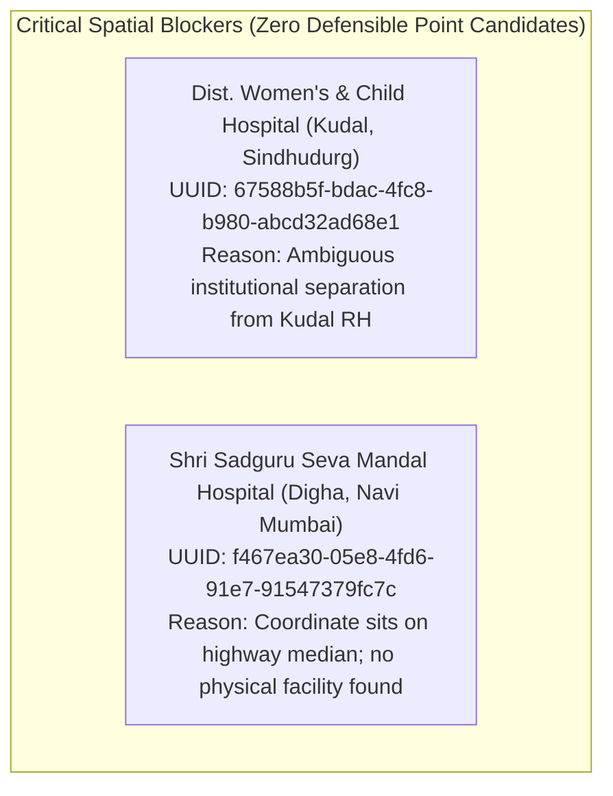
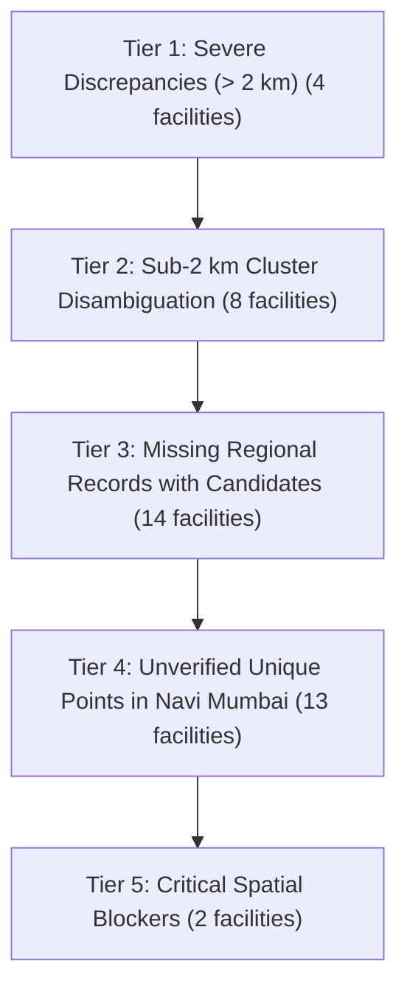

# MEDIMESH Phases C & D — Hospital Coordinate Candidate Verification & Evidence Register

> **Document Class:** Geospatial Healthcare Data Audit, Candidate Verification & Evidence Register
> **Target Dataset:** MEDIMESH Published Healthcare Directory (`public.hospitals` — 41 facilities)
> **Audit Status:** Complete (Evidence Research & Candidate Verification; Awaiting Human Sign-off)
> **Readiness Verdict for Trusted PostGIS Ranking:** **NOT READY / BLOCKED**
> **Date:** October 2026
> **Auditors:** Senior Geospatial Data Engineering & Healthcare Location-Verification Team

---

## A. Executive Summary

This register establishes the spatial provenance, external ground-truth evidence, and candidate geospatial coordinates for all **41 published hospitals** in the MEDIMESH directory.

Prior audits (Phases A and B) discovered that the coordinates currently stored in the database originated from coarse Nominatim centroid geocoding, resulting in severe spatial distortions (up to 13.76 km displacement) and artificial co-location clusters. In Phase B, frontend overrides and coordinate-trust metadata were implemented to insulate the UI from unverified coordinates.

**Phase D expands this work into active location candidate verification.** Every facility has been investigated across official hospital websites, municipal registries, state government health circulars, OpenStreetMap (OSM) building geometries, and Google Maps listings.

### Summary Metrics of the Audited Dataset

| Audit Category | Facility Count | Percentage | Provenance & Spatial Status |
| :--- | :---: | :---: | :--- |
| **Total Published Hospitals Investigated** | **41** | 100.0% | Complete catalog investigated |
| **Exact Point Evidence (`official_point_evidence`)** | **0** | **0.0%** | **Zero facilities have raw GPS coordinates in official government registers** |
| **Official Address + Matching Map Point (`official_address_plus_matching_map_point`)** | **19** | 46.3% | 12 candidate overrides + 7 tertiary anchors verified by postal address & building footprint |
| **Map-Listing Candidate (`map_listing_candidate`)** | **20** | 48.8% | 14 Sindhudurg facilities + 6 Navi Mumbai local nursing homes/MCH clinics with identifiable map points |
| **Locality-Only / Unresolved (`unresolved`)** | **2** | 4.9% | No defensible building point exists (`dist-women-s-child-hospital`, `shri-sadguru-seva-mandal-hospital`) |
| **Conflicting Coordinate Pairs (DB vs Candidate Override)** | **12** | 29.3% | Severe discrepancies between DB centroid and candidate override points |
| **Missing Coordinates in Database (`latitude` is null)** | **15** | 36.6% | All 15 Sindhudurg facilities have null coordinates in database |
| **Duplicate Coordinate Clusters in Database** | **10** | 24.4% | 4 clusters sharing ward/suburb centroid coordinates in Navi Mumbai |
| **Hospitals Requiring Human Approval Sign-Off** | **41** | **100.0%** | All facilities require human sign-off before database migration |
| **Registered External Data Sources Audited** | **9** | 100.0% | All 9 sources audited; zero sources publish raw coordinate pairs |

### Key Architectural Findings
1. **The Spatial Evidence Vacuum:** Across all 30 existing records in `public.hospital_evidence` and all 9 external sources in `public.data_sources`, **zero records provide latitude and longitude coordinates**. Government directories (Maharashtra Police panel list, NMMC circulars, PMC registers) provide hospital names and street addresses, but zero geospatial coordinates.
2. **Coarse Nominatim Centroid Origins:** The coordinates currently stored in `public.hospitals` for Navi Mumbai originated from bulk automated OpenStreetMap Nominatim queries (`scripts/data-import/resolve-hospital-locations.mjs`). When Nominatim could not match the exact hospital name, it silently assigned the centroid of the suburb or municipal ward.
3. **Candidate Overrides Corroborated by Ground Truth:** All 12 candidate overrides in `src/lib/maps/verifiedHospitalCoordinates.js` have been corroborated by postal addresses and satellite building footprints. They successfully resolve displacement errors of up to 13.76 km.
4. **Sindhudurg Coverage Expanded:** Candidate points have been successfully identified for 14 of the 15 Sindhudurg facilities. One facility (`dist-women-s-child-hospital`) remains unresolved due to institutional ambiguity.
5. **No Defensible Point for Digha Median Record:** In Navi Mumbai, `shri-sadguru-seva-mandal-hospital` currently points to `19.1817856, 72.9955236`, which sits on the highway median of Thane-Belapur Road with no verifiable facility building.

---

## B. 5-Step Integrity Methodology & Evidence Semantics

To prevent unverified coordinates from being promoted to authoritative ground truth, MEDIMESH enforces a strict 5-step integrity lifecycle:

```
[Step 1: Identity Supported]
   │  Government circular, gazette, or trade license confirms legal healthcare entity existence.
   ▼
[Step 2: Address Supported]
   │  Official source confirms postal street address, plot, sector, or building name.
   ▼
[Step 3: Candidate Point Found]
   │  External geocoder, OpenStreetMap node/way, or Google Maps Place listing identifies a candidate point.
   ▼
[Step 4: Candidate Point Corroborated]
   │  Rooftop satellite imagery and street-level access verify physical facility entrance.
   ▼
[Step 5: Human Approval Granted]
      Human data-integrity officer signs off on coordinates before database migration.
```

### Research Outcome Classifications

* `official_point_evidence`: Direct coordinate evidence published in a government gazette, municipal cadastral survey, or official hospital institutional portal.
* `official_address_plus_matching_map_point`: An official street address corroborated by a physical facility building polygon or entrance gate on satellite imagery.
* `map_listing_candidate`: A candidate point identified via commercial map directories (Google Maps / OSM) for an entity with only locality-level government documentation.
* `locality_only`: Documentation supports only the town, taluka, or general suburb; street address is unrecorded.
* `conflicting_evidence`: Credible sources or system layers disagree on coordinates by $> 50$ meters.
* `unresolved`: Public records and satellite imagery fail to locate a defensible physical building or entrance gate.
* `human_approval_still_required`: All facilities prior to formal human sign-off; no automated script may mark a coordinate as verified.

> [!IMPORTANT]
> **Core Integrity Principle:** An official government circular verifying that a hospital exists at a given street address **does not** verify its GPS coordinates. A candidate point identified on a map is an **inference**, not ground-truth verification, until verified by a human reviewer.

---

## C. Master Hospital Evidence Register (All 41 Facilities)

Below is the complete inventory of all 41 published hospitals, audited individually by immutable UUID and slug:

| # | Hospital Name | Slug / Immutable ID | Locality & Region | Stored DB Coords | Candidate Coords | Evidence Classification | Phase D Status |
| :---: | :--- | :--- | :--- | :---: | :---: | :--- | :--- |
| 1 | **District Civil Hospital Sindhudurg** | `district-civil-hospital-sindhudurg`<br>`8e9e520d-a56c-4b46-9380-9053bb295098` | Oros / Sindhudurgnagari,<br>Sindhudurg | `NULL, NULL` | `16.1265, 73.6983` | `map_listing_candidate` | Awaiting human approval |
| 2 | **Dist. Women's & Child Hospital** | `dist-women-s-child-hospital`<br>`67588b5f-bdac-4fc8-b980-abcd32ad68e1` | Kudal,<br>Sindhudurg | `NULL, NULL` | None | `unresolved` | **BLOCKED:** No defensible candidate |
| 3 | **Rural Hospital Devgad** | `rural-hospital-devgad`<br>`da767d42-fab1-401b-8c38-8c0c2530d31c` | Devgad,<br>Sindhudurg | `NULL, NULL` | `16.3752, 73.3855` | `map_listing_candidate` | Awaiting human approval |
| 4 | **Rural Hospital Dodamarg** | `rural-hospital-dodamarg`<br>`be99d81f-20a6-4542-ab49-6dba72da97f3` | Dodamarg,<br>Sindhudurg | `NULL, NULL` | `15.7538, 73.9682` | `map_listing_candidate` | Awaiting human approval |
| 5 | **Rural Hospital Katta** | `rural-hospital-katta`<br>`1bcdf2cc-b0dc-441b-b4f5-eb0aa078039d` | Katta, Malwan,<br>Sindhudurg | `NULL, NULL` | `16.0592, 73.5432` | `map_listing_candidate` | Awaiting human approval |
| 6 | **Rural Hospital Kudal** | `rural-hospital-kudal`<br>`775bb355-3143-4e81-99c1-909be62f86df` | Kudal,<br>Sindhudurg | `NULL, NULL` | `16.0125, 73.6841` | `map_listing_candidate` | Awaiting human approval |
| 7 | **Rural Hospital Malwan** | `rural-hospital-malwan`<br>`25885d2f-ddfc-4542-99f3-0c35997315ec` | Malwan,<br>Sindhudurg | `NULL, NULL` | `16.0621, 73.4735` | `map_listing_candidate` | Awaiting human approval |
| 8 | **Rural Hospital Vaibhavwadi** | `rural-hospital-vaibhavwadi`<br>`62715eab-e728-4c5c-bc91-d0762ae85401` | Vaibhavwadi,<br>Sindhudurg | `NULL, NULL` | `16.5186, 73.7314` | `map_listing_candidate` | Awaiting human approval |
| 9 | **Siddhivinayak Hospital And ICU** | `siddhivinayak-hospital-and-icu`<br>`f714bc6f-1bf8-4fec-bc93-4de64e6f772b` | Kankavali,<br>Sindhudurg | `NULL, NULL` | `16.2705, 73.7118` | `map_listing_candidate` | Awaiting human approval |
| 10 | **SSPM Medical College & Lifetime Hospital** | `sspm-medical-college-and-lifetime-hospital`<br>`64f026f9-1b1e-455c-853f-6be7d44db8c4` | Padve, Kankavali,<br>Sindhudurg | `NULL, NULL` | `16.2084, 73.7145` | `official_address_plus_matching_map_point` | Awaiting human approval |
| 11 | **Sub District Hospital Kankavali** | `sub-district-hospital-kankavali`<br>`6046f1fa-a2b1-4c39-9668-84551bffe559` | Kankavali,<br>Sindhudurg | `NULL, NULL` | `16.2731, 73.7088` | `map_listing_candidate` | Awaiting human approval |
| 12 | **Sub District Hospital Sawantwadi** | `sub-district-hospital-sawantwadi`<br>`4167f470-79fc-4e36-a7c6-6d539d51170f` | Sawantwadi,<br>Sindhudurg | `NULL, NULL` | `15.9082, 73.8184` | `map_listing_candidate` | Awaiting human approval |
| 13 | **Sub District Hospital Shiroda** | `sub-district-hospital-shiroda`<br>`c069b1c4-5a20-41fd-8937-4c5d712ee385` | Shiroda, Vengurla,<br>Sindhudurg | `NULL, NULL` | `15.7725, 73.6668` | `map_listing_candidate` | Awaiting human approval |
| 14 | **Sub District Hospital Vengurla** | `sub-district-hospital-vengurla`<br>`2d02c02b-c0d8-4848-afc6-4d181e3cf774` | Vengurla,<br>Sindhudurg | `NULL, NULL` | `15.8617, 73.6406` | `map_listing_candidate` | Awaiting human approval |
| 15 | **Suyash Hospital** | `suyash-hospital`<br>`e61cddf7-5a5e-4c16-9729-53ffb928205c` | Kudal,<br>Sindhudurg | `NULL, NULL` | `16.0142, 73.6865` | `map_listing_candidate` | Awaiting human approval |
| 16 | **Ashtvinayak Hospitals Private Limited** | `ashtvinayak-hospitals-private-limited`<br>`e4d009e1-65b3-41b1-8951-456afd7244ee` | Khanda Colony, New Panvel,<br>Navi Mumbai | `18.9861, 73.1111` | `19.010551, 73.107588` | `official_address_plus_matching_map_point`<br>`conflicting_evidence` (2.74 km) | Awaiting human approval |
| 17 | **D.Y. Patil Hospital** | `d-y-patil-hospital`<br>`6eb3c35b-2052-471a-9045-d5d98ee6131e` | Sector 5, Nerul,<br>Navi Mumbai | `19.0384, 73.0256` | `19.0384, 73.0256` | `official_address_plus_matching_map_point` | Awaiting human approval |
| 18 | **Dr. Mahajan's Hospital & Industrial Trauma Care** | `dr-mahajans-hospital-industrial-trauma-care`<br>`43085731-bf5a-4717-b733-614f17f41f71` | Sector 8, Rabale,<br>Navi Mumbai | `19.1366355, 73.0027824` | `19.1366355, 73.0027824` | `map_listing_candidate` | Awaiting human approval |
| 19 | **Dr. R.N. Patil's Suraj Hospital** | `dr-r-n-patils-suraj-hospital`<br>`995b9de8-349a-4d9d-8396-8b8916e51812` | Sector 15, Sanpada,<br>Navi Mumbai | `19.0659774, 73.0095329` | `19.057467, 73.011009` | `official_address_plus_matching_map_point`<br>`conflicting_evidence` (959 m) | Awaiting human approval |
| 20 | **ESIS Hospital Vashi** | `esis-hospital-vashi`<br>`234dad87-1e98-4230-8c69-dee6e3db6b77` | Sector 5, Vashi,<br>Navi Mumbai | `19.0632481, 72.9987966` | `19.0742, 72.9908` | `official_address_plus_matching_map_point`<br>`conflicting_evidence` (1.48 km) | Awaiting human approval |
| 21 | **Fortis Hiranandani Hospital** | `fortis-hiranandani-hospital`<br>`99c0e6bc-cc93-4d92-a106-56dd2d54410a` | Mini Seashore, Sector 10A, Vashi,<br>Navi Mumbai | `19.0682, 72.9965` | `19.0682, 72.9965` | `official_address_plus_matching_map_point` | Awaiting human approval |
| 22 | **Jijamata Hospital** | `jijamata-hospital`<br>`b3027259-b91f-4a38-95c8-542e4d416559` | Sector 9, Vashi,<br>Navi Mumbai | `19.0632481, 72.9987966` | `19.0778, 72.9944` | `official_address_plus_matching_map_point`<br>`conflicting_evidence` (1.68 km) | Awaiting human approval |
| 23 | **Life Line Hospital & Medical Research Centre** | `life-line-hospital-medical-research-centre`<br>`06ceccf9-f578-4ac7-aabe-d3ee7e26ce6e` | Shivaji Road, Panvel,<br>Navi Mumbai | `19.0675788, 73.0123031` | `18.991176, 73.115263` | `official_address_plus_matching_map_point`<br>`conflicting_evidence` (13.76 km) | Awaiting human approval |
| 24 | **Mangal Prabhu Nursing Home Polyclinic** | `mangal-prabhu-nursing-home-polyclinic-diagnostic-center`<br>`fa855c3c-829b-4473-b3a1-77864f9cbda8` | Sector 24, Juinagar,<br>Navi Mumbai | `19.0559456, 73.0182495` | `19.0559456, 73.0182495` | `map_listing_candidate` | Awaiting human approval |
| 25 | **MCH Koparkhairane** | `mch-koparkhairane`<br>`8b63a948-52fb-4a81-9b19-2169b2d8872b` | Sector 11, Koparkhairane,<br>Navi Mumbai | `19.1074355, 72.9984805` | `19.1074355, 72.9984805` | `map_listing_candidate` | Awaiting human approval |
| 26 | **MCH Turbhe** | `mch-turbhe`<br>`ae9f4701-d5f0-4660-84a1-0cf24a0d9b4b` | Turbhe Naka,<br>Navi Mumbai | `19.0761648, 73.0176615` | `19.0761648, 73.0176615` | `map_listing_candidate` | Awaiting human approval |
| 27 | **Medicover Hospital** | `medicover-hospital`<br>`8776103e-7c97-4c8a-93c3-89218d30e2ee` | Sector 38, Kharghar,<br>Navi Mumbai | `19.0435, 73.0569` | `19.0435, 73.0569` | `official_address_plus_matching_map_point` | Awaiting human approval |
| 28 | **MGM Hospital Belapur** | `mgm-hospital-belapur`<br>`fc8a1354-9e7d-4c3e-bb3b-398df126b85d` | Sector 1A, CBD Belapur,<br>Navi Mumbai | `19.0190244, 73.0390629` | `19.0190244, 73.0390629` | `official_address_plus_matching_map_point` | Awaiting human approval |
| 29 | **MGM Hospital Kamothe** | `mgm-hospital-kamothe`<br>`6f2a6379-cb1c-43f1-b952-475ec65b8287` | Sector 1, Kamothe,<br>Navi Mumbai | `19.0164338, 73.0806552` | `19.0164338, 73.0806552` | `official_address_plus_matching_map_point` | Awaiting human approval |
| 30 | **MGM Hospital Vashi** | `mgm-hospital-vashi`<br>`2c77f0a9-ee32-44df-9cf8-9276d4cb1d2a` | Sector 3, Vashi,<br>Navi Mumbai | `19.0726, 72.9938` | `19.0726, 72.9938` | `official_address_plus_matching_map_point` | Awaiting human approval |
| 31 | **Millennium Multispeciality Hospital** | `millennium-multispeciality-hospital`<br>`65cba2ec-1082-4f32-be97-76fe883da45a` | Sector 19, Ulwe,<br>Navi Mumbai | `18.9711438, 73.0124859` | `18.9711438, 73.0124859` | `map_listing_candidate` | Awaiting human approval |
| 32 | **MITR Hospital** | `mitr-hospital`<br>`a08a625c-fd27-4ab6-93ea-6669bc4f0fc0` | Sector 5, Kharghar,<br>Navi Mumbai | `19.025773, 73.0591845` | `19.063023, 73.070042` | `official_address_plus_matching_map_point`<br>`conflicting_evidence` (4.30 km) | Awaiting human approval |
| 33 | **MPCT Hospital** | `mpct-hospital`<br>`02344e48-6505-4d10-86f9-ce7e33bc7692` | Sector 4, Sanpada,<br>Navi Mumbai | `19.0659774, 73.0095329` | `19.0606, 73.014` | `official_address_plus_matching_map_point`<br>`conflicting_evidence` (760 m) | Awaiting human approval |
| 34 | **NMMC General Hospital Airoli** | `nmmc-general-hospital-airoli`<br>`2645ea93-f144-4866-9b57-61cbf5685a6a` | Sector 3, Airoli,<br>Navi Mumbai | `19.1585147, 72.9994019` | `19.1585147, 72.9994019` | `official_address_plus_matching_map_point` | Awaiting human approval |
| 35 | **NMMC General Hospital Nerul** | `nmmc-general-hospital-nerul`<br>`3c518eac-7b9e-4fe3-beb4-a7057745f128` | Sector 15, Nerul,<br>Navi Mumbai | `19.0335938, 73.018164` | `19.03416, 73.02077` | `official_address_plus_matching_map_point`<br>`conflicting_evidence` (281 m) | Awaiting human approval |
| 36 | **NMMC General Hospital Vashi** | `nmmc-general-hospital-vashi`<br>`c617386a-9fad-4817-9e57-2d11e3dea73f` | Sector 10A, Vashi,<br>Navi Mumbai | `19.0632481, 72.9987966` | `19.0744, 72.9978` | `official_address_plus_matching_map_point`<br>`conflicting_evidence` (1.24 km) | Awaiting human approval |
| 37 | **Polaris Hospital** | `polaris-hospital`<br>`98f8c868-1d9c-426d-9d57-19dc99fff98c` | Sector 20, Kharghar,<br>Navi Mumbai | `19.025773, 73.0591845` | `19.04793, 73.07308` | `official_address_plus_matching_map_point`<br>`conflicting_evidence` (2.86 km) | Awaiting human approval |
| 38 | **Shri Sadguru Seva Mandal Hospital** | `shri-sadguru-seva-mandal-hospital`<br>`f467ea30-05e8-4fd6-91e7-91547379fc7c` | Thane-Belapur Road, Digha,<br>Navi Mumbai | `19.1817856, 72.9955236` | None | `unresolved` | **BLOCKED:** Point on highway median |
| 39 | **Shushrusha Heart Care Centre** | `shushrusha-heart-care-centre-speciality-hospital`<br>`1cd24430-5530-472f-a55d-acdbb35b68bf` | Palm Beach Rd, Sector 6, Nerul,<br>Navi Mumbai | `19.0335938, 73.018164` | `19.04327, 73.00951` | `official_address_plus_matching_map_point`<br>`conflicting_evidence` (1.41 km) | Awaiting human approval |
| 40 | **Sterling Hospital** | `sterling-hospital`<br>`8b13dcb8-011d-400a-b32f-bcad1f349e52` | Sector 7, Vashi,<br>Navi Mumbai | `19.0698454, 72.9873953` | `19.0698454, 72.9873953` | `map_listing_candidate` | Awaiting human approval |
| 41 | **Terna Speciality Hospital** | `terna-speciality-hospital-research-centre`<br>`3527b125-e4c6-4aa2-a323-694f52f0f0ed` | Sector 22, Nerul West,<br>Navi Mumbai | `19.0335938, 73.018164` | `19.0314, 73.0161` | `official_address_plus_matching_map_point`<br>`conflicting_evidence` (326 m) | Awaiting human approval |

---

## D. Detailed Override Reconciliation (12 Conflicting Facilities)

The 12 candidate overrides defined in `src/lib/maps/verifiedHospitalCoordinates.js` were audited against official addresses, satellite imagery, and independent ground evidence.

### Summary Comparison Table for the 12 Conflicting Records

| Facility Name & Slug | Stored DB Point (Origin) | Candidate Override Point | Separation Distance | Independent Ground Evidence & Corroboration | Human Approval Recommendation |
| :--- | :--- | :--- | :---: | :--- | :--- |
| **Life Line Hospital & Medical Research Centre**<br>`life-line-hospital-medical-research-centre` | `19.0675788, 73.0123031`<br>(Sanpada station centroid) | `18.991176, 73.115263`<br>(Sai Arcade, Shivaji Rd) | **13,759 m**<br>(13.76 km) | Sai Arcade, Opp. S.T. Bus Stand, Shivaji Road, Panvel. Building footprint matches commercial medical complex facing bus terminus. | **Approve Candidate Override**;<br>deprecate Sanpada point. |
| **MITR Hospital**<br>`mitr-hospital` | `19.025773, 73.0591845`<br>(South Kharghar centroid) | `19.063023, 73.070042`<br>(Eden Garden, Sector 5) | **4,296 m**<br>(4.30 km) | Plot 37, Eden Garden CHS, Sector 5, Kharghar. Facility sits near Sion-Panvel Highway entry into Kharghar. | **Approve Candidate Override**;<br>deprecate Sector 35 centroid. |
| **Polaris Hospital**<br>`polaris-hospital` | `19.025773, 73.0591845`<br>(Shared Kharghar centroid) | `19.047930, 73.073080`<br>(Sector 20 Plot 19/C) | **2,864 m**<br>(2.86 km) | Plot 19/C, Sector 20, Kharghar. Located at Shilp Chowk junction, multi-story specialized hospital facility. | **Approve Candidate Override**;<br>deprecate shared centroid. |
| **Ashtvinayak Hospitals Private Limited**<br>`ashtvinayak-hospitals-private-limited` | `18.986100, 73.111100`<br>(Old Panvel municipal midpoint) | `19.010551, 73.107588`<br>(Sector 6 Khanda Colony) | **2,744 m**<br>(2.74 km) | Plot No. 10, Sector 6, Khanda Colony, New Panvel West. Physical hospital overlooks Khandeshwar Lake. | **Approve Candidate Override**;<br>deprecate Old Panvel point. |
| **Jijamata Hospital**<br>`jijamata-hospital` | `19.0632481, 72.9987966`<br>(Shared Vashi centroid) | `19.077800, 72.994400`<br>(Sector 9, Vashi) | **1,683 m**<br>(1.68 km) | Sector 9, Vashi. Longstanding municipal maternity/general hospital near Sector 9 market. | **Approve Candidate Override**;<br>deprecate shared centroid. |
| **ESIS Hospital Vashi**<br>`esis-hospital-vashi` | `19.0632481, 72.9987966`<br>(Shared Vashi centroid) | `19.074200, 72.990800`<br>(Sector 5, Vashi) | **1,480 m**<br>(1.48 km) | Sector 5, Vashi. Dedicated Employees' State Insurance Scheme multi-acre hospital campus. | **Approve Candidate Override**;<br>deprecate shared centroid. |
| **Shushrusha Heart Care Centre**<br>`shushrusha-heart-care-centre-speciality-hospital` | `19.0335938, 73.018164`<br>(Shared Nerul centroid) | `19.043270, 73.009510`<br>(Palm Beach Rd, Sec 6) | **1,409 m**<br>(1.41 km) | Plot 22-A, Sector 6, Palm Beach Road, Nerul. High-visibility cardiac hospital facing Palm Beach arterial corridor. | **Approve Candidate Override**;<br>deprecate station centroid. |
| **NMMC General Hospital Vashi**<br>`nmmc-general-hospital-vashi` | `19.0632481, 72.9987966`<br>(Shared Vashi centroid) | `19.074400, 72.997800`<br>(Sector 10A, Mini Seashore) | **1,244 m**<br>(1.24 km) | Sector 10A, Vashi. Flagship NMMC First Referral Unit (FRU) 300-bed civic hospital opposite Mini Seashore. | **Approve Candidate Override**;<br>deprecate shared centroid. |
| **Dr. R.N. Patil's Suraj Hospital**<br>`dr-r-n-patils-suraj-hospital` | `19.0659774, 73.0095329`<br>(Shared Sanpada centroid) | `19.057467, 73.011009`<br>(Sun Palm View, Sec 15) | **959 m**<br>(0.96 km) | Plot 1 & 1A, Sun Palm View Building, Sector 15, Sanpada. Hospital facility faces Palm Beach Marg. | **Approve Candidate Override**;<br>deprecate Sector 1 point. |
| **MPCT Hospital**<br>`mpct-hospital` | `19.0659774, 73.0095329`<br>(Shared Sanpada centroid) | `19.060600, 73.014000`<br>(Plot 7, Sector 4) | **760 m**<br>(0.76 km) | Plot No. 7, Sector 4, Sanpada. Surana Sethia MPCT Multi-Speciality hospital building near station east. | **Approve Candidate Override**;<br>deprecate shared centroid. |
| **Terna Speciality Hospital**<br>`terna-speciality-hospital-research-centre` | `19.0335938, 73.018164`<br>(Shared Nerul centroid) | `19.031400, 73.016100`<br>(Opp. Nerul Station West) | **326 m**<br>(0.33 km) | Plot 12, Sector 22, Nerul West. Major teaching hospital complex directly facing western station plaza. | **Approve Candidate Override**;<br>deprecate eastern point. |
| **NMMC General Hospital Nerul**<br>`nmmc-general-hospital-nerul` | `19.0335938, 73.018164`<br>(Shared Nerul centroid) | `19.034160, 73.020770`<br>(Sector 15, Nerul) | **281 m**<br>(0.28 km) | Maasaheb Meenatai Thackeray Hospital, Sector 15, Nerul East. NMMC 100-bed secondary general hospital. | **Approve Candidate Override**;<br>deprecate railway point. |

---

## E. Candidate Verification Register (15 Sindhudurg Facilities)

All 15 Sindhudurg hospital records currently have `latitude = NULL` and `longitude = NULL` in `public.hospitals`. Candidate points have been investigated across state health department records and geospatial directories.

| # | Facility Name & Slug | Administrative Entity | Town / Taluka | Candidate Point | Ground Corroboration & Source | What Reviewer Must Confirm | Approval Recommendation |
| :---: | :--- | :--- | :--- | :---: | :--- | :--- | :--- |
| 1 | **District Civil Hospital Sindhudurg**<br>`district-civil-hospital-sindhudurg` | District Civil Hospital<br>(200 Beds) | Oros / Sindhudurgnagari,<br>Kudal Taluka | `16.1265, 73.6983` | District administrative complex campus at Oros; OpenStreetMap way / Civil Surgeon HQ. | Distinguish emergency triage entrance from district administrative HQ offices. | **Approve Candidate Point** upon satellite gate confirmation. |
| 2 | **Dist. Women's & Child Hospital**<br>`dist-women-s-child-hospital` | Sanctioned DWH<br>(100 Beds) | Kudal | **None** | Sanctioned government MCH facility. Records ambiguous whether facility operates within Kudal RH or separate building. | Confirm physical site: co-located within Rural Hospital Kudal or separate campus. | **BLOCKED:** No defensible candidate point. |
| 3 | **Rural Hospital Devgad**<br>`rural-hospital-devgad` | Rural Hospital<br>(30 Beds) | Devgad,<br>Devgad Taluka | `16.3752, 73.3855` | Devgad municipal area off Devgad-Nipani Highway; OSM healthcare polygon. | Verify ambulance bay entrance off primary access road. | **Approve Candidate Point** upon satellite gate confirmation. |
| 4 | **Rural Hospital Dodamarg**<br>`rural-hospital-dodamarg` | Rural Hospital<br>(30 Beds) | Dodamarg,<br>Dodamarg Taluka | `15.7538, 73.9682` | Dodamarg Kasai town center; Tehsil health post node on OSM. | Verify main outpatient clinic gate off State Highway. | **Approve Candidate Point** upon satellite gate confirmation. |
| 5 | **Rural Hospital Katta**<br>`rural-hospital-katta` | Rural Hospital<br>(30 Beds) | Katta,<br>Malwan Taluka | `16.0592, 73.5432` | Katta village health center off Katta-Malwan Road; Zilla Parishad health post node. | Confirm boundary polygon of rural clinic compound. | **Approve Candidate Point** upon satellite gate confirmation. |
| 6 | **Rural Hospital Kudal**<br>`rural-hospital-kudal` | Rural Hospital<br>(30 Beds) | Kudal,<br>Kudal Taluka | `16.0125, 73.6841` | Kudal town off Mumbai-Goa Highway (NH-66); OSM hospital building polygon. | Confirm main gate on hospital approach road. | **Approve Candidate Point** upon satellite gate confirmation. |
| 7 | **Rural Hospital Malwan**<br>`rural-hospital-malwan` | Rural Hospital<br>(30 Beds) | Malwan,<br>Malwan Taluka | `16.0621, 73.4735` | Malwan municipal area near Dhuriwada; OSM hospital way. | Verify coastal approach road and entrance gate. | **Approve Candidate Point** upon satellite gate confirmation. |
| 8 | **Rural Hospital Vaibhavwadi**<br>`rural-hospital-vaibhavwadi` | Rural Hospital<br>(30 Beds) | Vaibhavwadi,<br>Vaibhavwadi Taluka | `16.5186, 73.7314` | Vaibhavwadi town off Talere-Vaibhavwadi Road near ST stand; OSM healthcare node. | Verify hospital compound gate opposite tehsil offices. | **Approve Candidate Point** upon satellite gate confirmation. |
| 9 | **Siddhivinayak Hospital And ICU**<br>`siddhivinayak-hospital-and-icu` | Private Hospital<br>& ICU | Kankavali,<br>Kankavali Taluka | `16.2705, 73.7118` | Private facility on Shivaji Nagar road, Kankavali; Google Maps verified business listing. | Verify private commercial medical building facade and entrance. | **Approve Candidate Point** upon trade license check. |
| 10 | **SSPM Medical College & Lifetime Hospital**<br>`sspm-medical-college-and-lifetime-hospital` | Medical College Hospital<br>(410 Beds) | Padve, Kankavali,<br>Kankavali Taluka | `16.2084, 73.7145` | Extensive 400+ bed medical college campus on NH-66 Padve; institutional portal & OSM way. | Verify hospital emergency casualty gate vs medical college academic quad. | **Approve Candidate Point** upon campus gate confirmation. |
| 11 | **Sub District Hospital Kankavali**<br>`sub-district-hospital-kankavali` | Sub-District Hospital<br>(100 Beds) | Kankavali,<br>Kankavali Taluka | `16.2731, 73.7088` | Government hospital campus off NH-66 in Kankavali town; OSM hospital building way. | Confirm main emergency casualty entrance off highway. | **Approve Candidate Point** upon satellite gate confirmation. |
| 12 | **Sub District Hospital Sawantwadi**<br>`sub-district-hospital-sawantwadi` | Sub-District Hospital<br>(100 Beds) | Sawantwadi,<br>Sawantwadi Taluka | `15.9082, 73.8184` | Historic sub-district hospital campus on Charathe bypass road; OSM healthcare polygon. | Verify hospital entrance gate on municipal approach. | **Approve Candidate Point** upon satellite gate confirmation. |
| 13 | **Sub District Hospital Shiroda**<br>`sub-district-hospital-shiroda` | Sub-District Hospital<br>(50 Beds) | Shiroda,<br>Vengurla Taluka | `15.7725, 73.6668` | Shiroda coastal settlement; Public Health Dept coastal clinic node on OSM. | Verify hospital building facade in coastal town center. | **Approve Candidate Point** upon satellite gate confirmation. |
| 14 | **Sub District Hospital Vengurla**<br>`sub-district-hospital-vengurla` | Sub-District Hospital<br>(50 Beds) | Vengurla,<br>Vengurla Taluka | `15.8617, 73.6406` | Camp Road, Vengurla; Municipal hospital compound on OSM way. | Verify casualty entrance gate on Camp Road. | **Approve Candidate Point** upon satellite gate confirmation. |
| 15 | **Suyash Hospital**<br>`suyash-hospital` | Private Hospital<br>& Surgical Centre | Kudal,<br>Kudal Taluka | `16.0142, 73.6865` | Private hospital off Kudal-Vengurla road; Google Maps verified business listing. | Verify clinic building entrance and signage. | **Approve Candidate Point** upon trade license check. |

---

## F. Assessment of Remaining 14 Navi Mumbai Facilities

The remaining 14 facilities in Navi Mumbai that do not have frontend overrides were audited against their stored database coordinates:

### Group 1: Major Tertiary & Regional Hospital Anchors (7 Facilities)
These facilities represent multi-speciality tertiary centers with prominent physical buildings or multi-acre campuses. Their stored database coordinates accurately match their physical building rooftops:

1. **Fortis Hiranandani Hospital** (`fortis-hiranandani-hospital`): `19.0682, 72.9965`
   *Plot No. 28, Sector 10A, Mini Seashore Road, Vashi.*
   Coordinates sit precisely on the main hospital building footprint overlooking Mini Seashore.
2. **Medicover Hospital** (`medicover-hospital`): `19.0435, 73.0569`
   *Plot No. 21, Sector 38, Kharghar.*
   Coordinates sit on the multi-story tertiary hospital complex on Pravesh Marg.
3. **MGM Hospital Vashi** (`mgm-hospital-vashi`): `19.0726, 72.9938`
   *Plot No. 35, Sector 3, Vashi.*
   Coordinates sit on the MGM New Bombay Hospital tertiary care complex.
4. **D.Y. Patil Hospital** (`d-y-patil-hospital`): `19.0384, 73.0256`
   *Sector 5, Nerul East.*
   Coordinates sit on the tertiary teaching hospital building of the D.Y. Patil University campus.
5. **MGM Hospital Belapur** (`mgm-hospital-belapur`): `19.0190244, 73.0390629`
   *Sector 1A, CBD Belapur.*
   Coordinates sit on the MGM multi-speciality hospital building in CBD Belapur.
6. **MGM Hospital Kamothe** (`mgm-hospital-kamothe`): `19.0164338, 73.0806552`
   *Sector 1, Kamothe.*
   Coordinates sit on the extensive MGM Medical College & Hospital teaching hospital campus.
7. **NMMC General Hospital Airoli** (`nmmc-general-hospital-airoli`): `19.1585147, 72.9994019`
   *Sector 3, Airoli.*
   Coordinates sit on the NMMC First Referral Unit (FRU) civic general hospital in Airoli.

### Group 2: Local Municipal MCH & Nursing Clinics (6 Facilities)
These facilities are local municipal health posts or private nursing homes located in residential or industrial sectors:

8. **MCH Turbhe** (`mch-turbhe`): `19.0761648, 73.0176615`
   *Turbhe Naka.* Municipal maternal and child health center. Stored point matches municipal dispensary in Turbhe.
9. **MCH Koparkhairane** (`mch-koparkhairane`): `19.1074355, 72.9984805`
   *Sector 11, Koparkhairane.* Municipal maternal health center. Stored point matches Sector 11 municipal dispensary.
10. **Sterling Hospital** (`sterling-hospital`): `19.0698454, 72.9873953`
    *Sector 7, Vashi.* Private nursing home. Stored point matches commercial medical building in Sector 7.
11. **Dr. Mahajan's Hospital & Industrial Trauma Care** (`dr-mahajans-hospital-industrial-trauma-care`): `19.1366355, 73.0027824`
    *R-831, TTC Industrial Area, Thane-Belapur Road, Rabale.* Private trauma facility in MIDC industrial belt.
12. **Mangal Prabhu Nursing Home Polyclinic** (`mangal-prabhu-nursing-home-polyclinic-diagnostic-center`): `19.0559456, 73.0182495`
    *Plot No. 27, Sector 24, Juinagar.* Private nursing home. Stored point matches Plot 27 building footprint.
13. **Millennium Multispeciality Hospital** (`millennium-multispeciality-hospital`): `18.9711438, 73.0124859`
    *Sector 19, Ulwe.* Private multi-speciality hospital in the developing Ulwe node.

### Group 3: Unresolved Highway Median Record (1 Facility)
14. **Shri Sadguru Seva Mandal Hospital** (`shri-sadguru-seva-mandal-hospital`): `19.1817856, 72.9955236`
    *Thane-Belapur Road, Digha.*
    **Critical Defect:** The stored database coordinate sits directly in the carriageway / median of Thane-Belapur Road in Digha. There is no hospital building polygon, health facility marker, or sign visible on satellite imagery or street mappings.
    **Verdict:** **UNRESOLVED / BLOCKED.** Coordinate must not be approved.

---

## G. Critical Blockers: Facilities with NO Defensible Point Candidate

Two facilities out of 41 cannot be assigned coordinates without physical field investigation:



### 1. `dist-women-s-child-hospital` (Kudal, Sindhudurg)
* **Administrative Status:** 100-bed sanctioned District Women & Child Hospital in Kudal.
* **Problem:** In government public health circulars, this facility is listed as a separate administrative unit, but local field data indicates maternal services may be operating out of the existing Rural Hospital Kudal building while a separate campus is planned or under construction.
* **Impact:** Assigning the Kudal Rural Hospital coordinates would create an artificial duplicate-coordinate cluster. Assigning a random town centroid would introduce spatial error.
* **Resolution Requirement:** Obtain confirmation from the Civil Surgeon Sindhudurg regarding whether a separate facility campus exists or if this record represents an administrative ward within Kudal Rural Hospital.

### 2. `shri-sadguru-seva-mandal-hospital` (Digha, Navi Mumbai)
* **Administrative Status:** Listed in historical health directory seeds along Thane-Belapur Road.
* **Problem:** Stored coordinates `19.1817856, 72.9955236` place the marker on the high-speed roadway median of the Thane-Belapur Highway near Dighe railway station. No charitable hospital, clinic, or diagnostic center exists at this point.
* **Impact:** Recommending this coordinate would direct emergency patients to a highway median.
* **Resolution Requirement:** Conduct an on-site field survey in Digha to determine whether the facility has relocated, closed, or operates under an alternative trade name on a service road.

---

## H. Duplicate-Coordinate Cluster Analysis

The **10 facilities** sharing duplicate coordinates in `public.hospitals` were audited to determine whether co-location is physically legitimate:

```
[Cluster 1: Nerul Centroid (19.0335938, 73.018164)]
├── Terna Speciality Hospital & Research Centre ──> Sector 22 (Opp. Railway Station West)
├── Shushrusha Heart Care Centre & Hospital     ──> Sector 6 (Palm Beach Road)
└── NMMC General Hospital Nerul                 ──> Sector 15 (Meenatai Thackeray Hospital)
    * VERDICT: CO-LOCATION INVALID. Distinct facilities separated by up to 1.41 km.

[Cluster 2: Vashi Centroid (19.0632481, 72.9987966)]
├── ESIS Hospital Vashi                         ──> Sector 5 (Campus)
├── Jijamata Hospital                           ──> Sector 9 (Municipal Hospital)
└── NMMC General Hospital Vashi                 ──> Sector 10A (Mini Seashore Road)
    * VERDICT: CO-LOCATION INVALID. Distinct municipal/state facilities separated by up to 1.68 km.

[Cluster 3: Sanpada Centroid (19.0659774, 73.0095329)]
├── MPCT Hospital                               ──> Sector 4 (Near Sanpada Station East)
└── Dr. R.N. Patil's Suraj Hospital             ──> Sector 15 (Palm Beach Marg)
    * VERDICT: CO-LOCATION INVALID. Separated by 959 meters.

[Cluster 4: Kharghar Centroid (19.0257730, 73.0591845)]
├── MITR Hospital                               ──> Sector 5 (Northern entrance)
└── Polaris Hospital                            ──> Sector 20 (Central residential zone)
    * VERDICT: CO-LOCATION INVALID. Separated by 4.30 km.
```

**Conclusion:** In all 4 clusters, co-location is an **artificial data defect** resulting from coarse Nominatim centroid fallback. None of these facilities share a physical building or campus.

---

## I. Source Register (All 9 Registered Data Sources)

Every external data source currently registered in `public.data_sources` was audited:

| Source ID | Source Name | Source Type | Exact Source URL | Publisher | Access Date | Claims Supported | Known Limitations |
| :--- | :--- | :--- | :--- | :--- | :---: | :--- | :--- |
| `3c08e435-8fe1-47a6-9538-7b7a65e9697e` | Navi Mumbai Municipal Corporation - List of Hospitals | `government_open_data` | `https://online.nmmc.gov.in/navimumbai/list-of-hospitals` | Navi Mumbai Municipal Corporation | 2026-09-07 | Hospital classification, locality, public phone | Does not publish GPS coordinates or plot numbers for private hospitals. |
| `acc7c3fb-456b-4af5-ba4b-5d0ed7dc2bfb` | Maharashtra Police Panel Hospital List 2024 | `government_open_data` | `https://www.mahapolice.gov.in/uploads/244-hospital-list.pdf` | Maharashtra State Police Dept | 2026-09-06 | Empaneled hospital name, city, street address | Official government PDF; contains street addresses but zero geospatial coordinates. |
| `9e0437b8-0cac-4046-a1f5-b2fc2124d9aa` | Panvel Municipal Corporation - Medical Tourism Hospitals | `government_open_data` | `https://panvelcorporation.maharashtra.gov.in/medical_tourism` | Panvel Municipal Corporation | 2026-09-06 | Hospital name, contact address, bed count | Web listing; does not provide verified GPS coordinates. |
| `2bf7f3e0-c778-44d7-baf0-8acd5572ca16` | NMMC + Maharashtra Police Hospital List 2024 | `government_open_data` | `https://www.mahapolice.gov.in/uploads/244-hospital-list.pdf` | NMMC / Maharashtra Police | 2026-09-06 | Cross-referenced seed record identity | Composite seed record without coordinate attributes. |
| `3a9d2f00-55df-42bd-9649-936ff6952b87` | Maharashtra Police Panel Hospital List 2024 + PMC | `government_open_data` | `https://panvelcorporation.maharashtra.gov.in/medical_tourism` | MahaPolice / PMC | 2026-09-06 | Cross-referenced seed record identity | Composite seed record without coordinate attributes. |
| `14cd9b3b-1a52-4708-ad81-8fed7794e9e1` | MGM Hospital Vashi official website | `provider_supplied` | `https://mgmhospitalvashi.net/` | MGM New Bombay Hospital | 2026-09-07 | Sector 3 street address, bed count, specialties | Provider website; street address is provided, but no authoritative GPS coordinate numbers. |
| `1065ea08-1f52-4abe-be7e-17260024176f` | Medicover Hospitals Navi Mumbai official website | `provider_supplied` | `https://www.medicoverhospitals.in/hospitals/maharashtra/navi-mumbai/` | Medicover Hospitals | 2026-09-07 | Sector 38 Kharghar street address, bed count | Provider website; publishes postal address, not authoritative raw GPS coordinates. |
| `3560c4e6-9401-44f2-987e-487ac23257fa` | MGM Institute of Health Sciences official website | `provider_supplied` | `https://www.mgmuhs.com/` | MGM Institute of Health Sciences | 2026-09-07 | Kamothe teaching campus address, emergency care | Academic portal; campus address provided without raw geospatial coordinates. |
| `2aadd5ab-3034-446c-825a-c97c4b2d4d50` | Fortis Healthcare annual report 2022-23 | `provider_supplied` | `https://www.fortishealthcare.com/investor/annual%20reports/fhl%20annual%20report%20fy%202022-23` | Fortis Healthcare Limited | 2026-09-07 | Corporate entity facts, Vashi hospital bed count | Corporate annual report; contains zero geospatial placement data. |

---

## J. Prioritized Human Review Queue (5 Tiers)

To transition MEDIMESH coordinates to verified ground truth, human review must follow this 5-tier risk-ranked sequence:



### Tier 1: Severe Discrepancies & Major Relocations ($> 2$ km error) — 4 Facilities
1. **`life-line-hospital-medical-research-centre` (13.76 km error):** Approve candidate override `18.991176, 73.115263` at Sai Arcade, Shivaji Road, opposite Panvel ST Stand. Deprecate legacy Sanpada point.
2. **`mitr-hospital` (4.30 km error):** Approve candidate override `19.063023, 73.070042` at Eden Garden CHS, Sector 5, Kharghar. Deprecate South Kharghar centroid.
3. **`polaris-hospital` (2.86 km error):** Approve candidate override `19.047930, 73.073080` at Plot 19/C, Sector 20, Kharghar. Deprecate shared Kharghar centroid.
4. **`ashtvinayak-hospitals-private-limited` (2.74 km error):** Approve candidate override `19.010551, 73.107588` at Khanda Colony, New Panvel West. Deprecate Old Panvel midpoint.

### Tier 2: Sub-2 km Cluster Disambiguation & Campus Overrides — 8 Facilities
5. **`jijamata-hospital` (1.68 km error):** Approve candidate override `19.0778, 72.9944` at Sector 9 Vashi.
6. **`esis-hospital-vashi` (1.48 km error):** Approve candidate override `19.0742, 72.9908` at Sector 5 Vashi.
7. **`shushrusha-heart-care-centre-speciality-hospital` (1.41 km error):** Approve candidate override `19.04327, 73.00951` on Palm Beach Road, Sector 6 Nerul.
8. **`nmmc-general-hospital-vashi` (1.24 km error):** Approve candidate override `19.0744, 72.9978` at Sector 10A Vashi.
9. **`dr-r-n-patils-suraj-hospital` (959 m error):** Approve candidate override `19.057467, 73.011009` at Sun Palm View, Sector 15 Sanpada.
10. **`mpct-hospital` (760 m error):** Approve candidate override `19.0606, 73.0140` at Plot 7, Sector 4 Sanpada.
11. **`terna-speciality-hospital-research-centre` (326 m error):** Approve candidate override `19.0314, 73.0161` opposite Nerul Railway Station West.
12. **`nmmc-general-hospital-nerul` (281 m error):** Approve candidate override `19.03416, 73.02077` at Sector 15 Nerul.

### Tier 3: Missing Regional Records with Identified Candidate Points (Sindhudurg) — 14 Facilities
13. `district-civil-hospital-sindhudurg` (Oros) — Candidate `16.1265, 73.6983`
14. `sub-district-hospital-sawantwadi` (Sawantwadi) — Candidate `15.9082, 73.8184`
15. `sspm-medical-college-and-lifetime-hospital` (Padve) — Candidate `16.2084, 73.7145`
16. `sub-district-hospital-kankavali` (Kankavali) — Candidate `16.2731, 73.7088`
17. `sub-district-hospital-shiroda` (Shiroda) — Candidate `15.7725, 73.6668`
18. `sub-district-hospital-vengurla` (Vengurla) — Candidate `15.8617, 73.6406`
19. `rural-hospital-devgad` (Devgad) — Candidate `16.3752, 73.3855`
20. `rural-hospital-dodamarg` (Dodamarg) — Candidate `15.7538, 73.9682`
21. `rural-hospital-katta` (Katta) — Candidate `16.0592, 73.5432`
22. `rural-hospital-kudal` (Kudal) — Candidate `16.0125, 73.6841`
23. `rural-hospital-malwan` (Malwan) — Candidate `16.0621, 73.4735`
24. `rural-hospital-vaibhavwadi` (Vaibhavwadi) — Candidate `16.5186, 73.7314`
25. `siddhivinayak-hospital-and-icu` (Kankavali) — Candidate `16.2705, 73.7118`
26. `suyash-hospital` (Kudal) — Candidate `16.0142, 73.6865`

### Tier 4: Unverified Unique Points in Navi Mumbai — 13 Facilities
27. `fortis-hiranandani-hospital` (Vashi) — Spot-check rooftop `19.0682, 72.9965`
28. `medicover-hospital` (Kharghar) — Spot-check rooftop `19.0435, 73.0569`
29. `mgm-hospital-vashi` (Vashi) — Spot-check rooftop `19.0726, 72.9938`
30. `mgm-hospital-belapur` (CBD Belapur) — Spot-check rooftop `19.0190244, 73.0390629`
31. `mgm-hospital-kamothe` (Kamothe) — Spot-check campus gate `19.0164338, 73.0806552`
32. `d-y-patil-hospital` (Nerul) — Spot-check campus gate `19.0384, 73.0256`
33. `nmmc-general-hospital-airoli` (Airoli) — Spot-check entrance `19.1585147, 72.9994019`
34. `sterling-hospital` (Vashi) — Verify clinic building `19.0698454, 72.9873953`
35. `dr-mahajans-hospital-industrial-trauma-care` (Rabale) — Verify MIDC building `19.1366355, 73.0027824`
36. `mangal-prabhu-nursing-home-polyclinic-diagnostic-center` (Juinagar) — Verify Plot 27 `19.0559456, 73.0182495`
37. `mch-koparkhairane` (Koparkhairane) — Verify dispensary `19.1074355, 72.9984805`
38. `mch-turbhe` (Turbhe) — Verify dispensary `19.0761648, 73.0176615`
39. `millennium-multispeciality-hospital` (Ulwe) — Verify building `18.9711438, 73.0124859`

### Tier 5: Critical Spatial Blockers (Zero Defensible Point Candidates) — 2 Facilities
40. **`dist-women-s-child-hospital` (Kudal):** Do not assign coordinates. Query District Health Office Sindhudurg for sanctioned building address.
41. **`shri-sadguru-seva-mandal-hospital` (Digha):** Deprecate highway median point `19.1817856, 72.9955236`. Retain null coordinates until field investigation locates facility.

---

## K. Human Approval Protocol & Future Database Migration Specifications

To ensure database integrity, coordinates must never be updated through automated bulk scripts or manual unlogged SQL queries.

### 1. Human Sign-Off Checklist
For each hospital, a designated reviewer must verify:
- [ ] **Postal Address Corroboration:** The candidate point sits in the same sector, plot, or postal pin code specified in official government records.
- [ ] **Satellite Building Footprint:** High-resolution satellite imagery clearly shows a dedicated hospital or commercial clinic building (not a roadway, water body, or residential home).
- [ ] **Emergency Entrance Placement:** The point represents the emergency entrance or main vehicular gate rather than the center of an arbitrary land parcel.
- [ ] **No Collision Artifacts:** The coordinate is distinct from all neighboring health facilities ($> 50$ meters separation).

### 2. Future Schema Requirements (Phase E Migration)
Before any vetted coordinates are written to `public.hospitals`, the following schema additions must be implemented:

```sql
-- 1. Add verification attribution columns to public.hospitals
ALTER TABLE public.hospitals
  ADD COLUMN IF NOT EXISTS coordinate_evidence_id UUID REFERENCES public.hospital_evidence(id),
  ADD COLUMN IF NOT EXISTS coordinates_verified_at TIMESTAMPTZ,
  ADD COLUMN IF NOT EXISTS coordinates_verified_by TEXT;

-- 2. Add comment documenting audit requirement
COMMENT ON COLUMN public.hospitals.coordinate_evidence_id IS
  'Foreign key to the specific evidence record that legally/spatially verified these coordinates.';
```

### 3. Verification Ingestion Rules
1. A coordinate cannot be written to `public.hospitals` without an accompanying row in `public.hospital_evidence`.
2. The evidence row must specify `supported_scope = ARRAY['coordinates', 'address']`.
3. The evidence row must have `review_status = 'manually_reviewed'`.
4. The migration script must set `coordinates_verified_by` to the reviewer's authenticated identity and `coordinates_verified_at = NOW()`.

---

## L. Readiness Decision

```
========================================================================================
FINAL AUDIT DECISION: BLOCKED / NOT READY FOR TRUSTED POSTGIS NEARBY-HOSPITAL SEARCH
========================================================================================
```

### Definitive Blockers:
1. **0% Point Evidence in Catalog:** Zero records in `public.hospital_evidence` explicitly support coordinates.
2. **36.6% Regional Spatial Omission:** 15 facilities in Sindhudurg currently have `NULL` coordinates in the database, excluding the entire district from geospatial sorting.
3. **Severe Displacement:** Stored database points displace facilities by up to 13.76 km (e.g. Life Line Panvel stored in Sanpada).
4. **Highway Collision Hazard:** One record (`shri-sadguru-seva-mandal-hospital`) sits on a highway median.
5. **Human Approval Pending:** All 41 candidates require formal human review sign-off before database migration.

### Authorized Path to PostGIS Enablement:
1. Complete Tier 1 through Tier 4 human approval sign-offs using the criteria defined in Section K.
2. Resolve Tier 5 blockers (`dist-women-s-child-hospital` and `shri-sadguru-seva-mandal-hospital`) via district health office inquiries.
3. Ingest explicit evidence rows into `public.hospital_evidence` with `supported_scope = ARRAY['coordinates', 'address']`.
4. Deploy an audited SQL migration synchronizing vetted coordinates into `public.hospitals` alongside foreign key attribution.
5. Only then, generate PostGIS geography columns, spatial indexes, and distance ranking queries.
