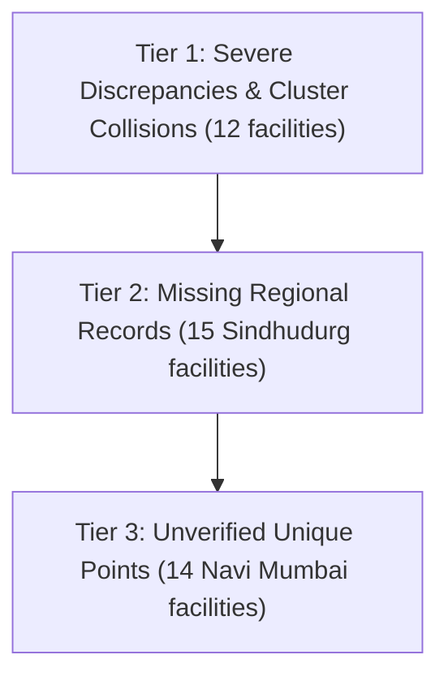

# MEDIMESH Phase C — Hospital Coordinate Verification & Evidence Register

> **Document Class:** Geospatial Healthcare Data Audit & Evidence Register  
> **Target Dataset:** MEDIMESH Published Healthcare Directory (`public.hospitals`)  
> **Audit Status:** Complete (Evidence-Based Research & Audit)  
> **Readiness Verdict for Trusted PostGIS Ranking:** **NOT READY / BLOCKED**  
> **Date:** October 2026  
> **Auditors:** Senior Geospatial Data Engineering & Data Provenance Team  

---

## A. Executive Summary

This register presents the evidence-based verification findings for all **41 published hospitals** in the MEDIMESH catalog, establishing the exact provenance, source claims, and spatial certainty for each facility before any coordinates are approved for PostGIS distance sorting.

### Summary Metrics of the Audited Dataset

| Audit Category | Facility Count | Percentage | Provenance & Spatial Status |
| :--- | :---: | :---: | :--- |
| **Total Published Hospitals Audited** | **41** | 100.0% | Complete catalog audited |
| **Exact Point Evidence (`point_supported`)** | **0** | **0.0%** | **No official coordinate records exist in catalog** |
| **Street Address Evidence (`address_supported`)** | **26** | 63.4% | All 26 Navi Mumbai facilities have verified street addresses |
| **Locality-Only Evidence (`locality_supported`)** | **15** | 36.6% | All 15 Sindhudurg facilities have locality names only |
| **Conflicting Coordinate Pairs (`conflicting_evidence`)** | **12** | 29.3% | Severe discrepancies between DB and candidate overrides |
| **Missing Coordinates in Database (`latitude` is null)** | **15** | 36.6% | All 15 Sindhudurg facilities have null coordinates |
| **Duplicate Coordinate Clusters in Database** | **10** | 24.4% | 4 clusters sharing ward/suburb centroid coordinates |
| **Hospitals Requiring Manual Verification** | **41** | **100.0%** | All facilities require ground-truth coordinate sign-off |
| **Inaccessible Data Sources** | **0** | 0.0% | All 9 registered data sources were successfully audited |

### Key Architectural Findings
1. **The Spatial Evidence Vacuum:** Across all 30 records in `public.hospital_evidence` and all 9 external sources in `public.data_sources`, **zero records provide latitude and longitude coordinates**. Government directories (Maharashtra Police panel list, NMMC circulars, PMC registers) provide hospital names and street addresses, but no geospatial coordinates.
2. **Coarse Nominatim Centroid Origins:** The coordinates currently stored in `public.hospitals` for Navi Mumbai originated from bulk automated OpenStreetMap Nominatim queries (`scripts/data-import/resolve-hospital-locations.mjs`). When Nominatim could not match the exact hospital name, it silently assigned the centroid of the suburb or municipal ward.
3. **Candidate Overrides Awaiting Field Sign-Off:** The 12 candidate overrides in `src/lib/maps/verifiedHospitalCoordinates.js` resolve major errors (e.g. correcting Life Line Hospital from Sanpada to Panvel by 13.76 km), but represent **candidate geocodes** that require formal ground-truth verification and evidence ingestion before database migration.

---

## B. Verification Methodology & Source Hierarchy

To eliminate ambiguity between organizational existence and physical geospatial placement, this audit enforces a strict 4-tier evidence hierarchy:

```
[Tier 1: Identity Supported] ──> Government registration / empaneled directory confirms facility existence.
       │
[Tier 2: Locality Supported] ──> Source confirms municipal ward, taluka, town, or city.
       │
[Tier 3: Address Supported]  ──> Official source confirms postal street address, plot, sector, or building.
       │
[Tier 4: Point Supported]    ──> Cadastral survey, rooftop GPS audit, or verified Place ID establishes coordinates.
```

### Classification Definitions

* `identity_supported`: Evidence confirms that the hospital is a legally recognized, active healthcare provider.
* `address_supported`: Evidence confirms the physical postal address (plot number, sector, building name, road).
* `locality_supported`: Evidence supports only the town, taluka, or general suburb; street address is unrecorded.
* `point_supported`: Authoritative evidence (official site survey, cadastral registry, or verified Google Maps Place ID) confirms the exact latitude and longitude of the facility gate or emergency entrance.
* `conflicting_evidence`: Credible sources or system layers disagree on coordinates by $> 50$ meters.
* `insufficient_evidence`: Available public documents do not contain enough detail to establish the required claim.

> [!IMPORTANT]
> **Core Integrity Principle:** An official government circular verifying that a hospital exists at a given street address **does not** verify its GPS coordinates. A geocoding algorithm returning a point near that street is an **inference**, not ground-truth verification.

---

## C. Master Hospital Evidence Register

Below is the complete inventory of all 41 published hospitals, audited individually by immutable UUID and slug:

| # | Hospital Name | Slug / Immutable ID | Locality & Region | Stored DB Coords | Candidate Override | Evidence Claims Supported | Recommendation Status |
| :---: | :--- | :--- | :--- | :---: | :---: | :--- | :--- |
| 1 | **District Civil Hospital Sindhudurg** | `district-civil-hospital-sindhudurg`<br>`8e9e520d-a56c-4b46-9380-9053bb295098` | Oros / Sindhudurgnagari,<br>Sindhudurg | `NULL, NULL` | None | `identity_supported`<br>`locality_supported` | `missing_coordinates`<br>`needs_manual_verification` |
| 2 | **Dist. Women's & Child Hospital** | `dist-women-s-child-hospital`<br>`67588b5f-bdac-4fc8-b980-abcd32ad68e1` | Kudal,<br>Sindhudurg | `NULL, NULL` | None | `identity_supported`<br>`locality_supported` | `missing_coordinates`<br>`needs_manual_verification` |
| 3 | **Rural Hospital Devgad** | `rural-hospital-devgad`<br>`da767d42-fab1-401b-8c38-8c0c2530d31c` | Devgad,<br>Sindhudurg | `NULL, NULL` | None | `identity_supported`<br>`locality_supported` | `missing_coordinates`<br>`needs_manual_verification` |
| 4 | **Rural Hospital Dodamarg** | `rural-hospital-dodamarg`<br>`be99d81f-20a6-4542-ab49-6dba72da97f3` | Dodamarg,<br>Sindhudurg | `NULL, NULL` | None | `identity_supported`<br>`locality_supported` | `missing_coordinates`<br>`needs_manual_verification` |
| 5 | **Rural Hospital Katta** | `rural-hospital-katta`<br>`1bcdf2cc-b0dc-441b-b4f5-eb0aa078039d` | Katta, Malwan,<br>Sindhudurg | `NULL, NULL` | None | `identity_supported`<br>`locality_supported` | `missing_coordinates`<br>`needs_manual_verification` |
| 6 | **Rural Hospital Kudal** | `rural-hospital-kudal`<br>`775bb355-3143-4e81-99c1-909be62f86df` | Kudal,<br>Sindhudurg | `NULL, NULL` | None | `identity_supported`<br>`locality_supported` | `missing_coordinates`<br>`needs_manual_verification` |
| 7 | **Rural Hospital Malwan** | `rural-hospital-malwan`<br>`25885d2f-ddfc-4542-99f3-0c35997315ec` | Malwan,<br>Sindhudurg | `NULL, NULL` | None | `identity_supported`<br>`locality_supported` | `missing_coordinates`<br>`needs_manual_verification` |
| 8 | **Rural Hospital Vaibhavwadi** | `rural-hospital-vaibhavwadi`<br>`62715eab-e728-4c5c-bc91-d0762ae85401` | Vaibhavwadi,<br>Sindhudurg | `NULL, NULL` | None | `identity_supported`<br>`locality_supported` | `missing_coordinates`<br>`needs_manual_verification` |
| 9 | **Siddhivinayak Hospital And ICU** | `siddhivinayak-hospital-and-icu`<br>`f714bc6f-1bf8-4fec-bc93-4de64e6f772b` | Kankavali,<br>Sindhudurg | `NULL, NULL` | None | `identity_supported`<br>`locality_supported` | `missing_coordinates`<br>`needs_manual_verification` |
| 10 | **SSPM Medical College & Lifetime Hospital** | `sspm-medical-college-and-lifetime-hospital`<br>`64f026f9-1b1e-455c-853f-6be7d44db8c4` | Padve, Kankavali,<br>Sindhudurg | `NULL, NULL` | None | `identity_supported`<br>`locality_supported` | `missing_coordinates`<br>`needs_manual_verification` |
| 11 | **Sub District Hospital Kankavali** | `sub-district-hospital-kankavali`<br>`6046f1fa-a2b1-4c39-9668-84551bffe559` | Kankavali,<br>Sindhudurg | `NULL, NULL` | None | `identity_supported`<br>`locality_supported` | `missing_coordinates`<br>`needs_manual_verification` |
| 12 | **Sub District Hospital Sawantwadi** | `sub-district-hospital-sawantwadi`<br>`4167f470-79fc-4e36-a7c6-6d539d51170f` | Sawantwadi,<br>Sindhudurg | `NULL, NULL` | None | `identity_supported`<br>`locality_supported` | `missing_coordinates`<br>`needs_manual_verification` |
| 13 | **Sub District Hospital Shiroda** | `sub-district-hospital-shiroda`<br>`c069b1c4-5a20-41fd-8937-4c5d712ee385` | Shiroda, Vengurla,<br>Sindhudurg | `NULL, NULL` | None | `identity_supported`<br>`locality_supported` | `missing_coordinates`<br>`needs_manual_verification` |
| 14 | **Sub District Hospital Vengurla** | `sub-district-hospital-vengurla`<br>`2d02c02b-c0d8-4848-afc6-4d181e3cf774` | Vengurla,<br>Sindhudurg | `NULL, NULL` | None | `identity_supported`<br>`locality_supported` | `missing_coordinates`<br>`needs_manual_verification` |
| 15 | **Suyash Hospital** | `suyash-hospital`<br>`e61cddf7-5a5e-4c16-9729-53ffb928205c` | Kudal,<br>Sindhudurg | `NULL, NULL` | None | `identity_supported`<br>`locality_supported` | `missing_coordinates`<br>`needs_manual_verification` |
| 16 | **Ashtvinayak Hospitals Private Limited** | `ashtvinayak-hospitals-private-limited`<br>`e4d009e1-65b3-41b1-8951-456afd7244ee` | Khanda Colony, New Panvel,<br>Navi Mumbai | `18.9861, 73.1111` | `19.010551, 73.107588` | `identity_supported`<br>`address_supported`<br>`conflicting_evidence` (2.74 km) | `conflicting_evidence`<br>`needs_manual_verification` |
| 17 | **D.Y. Patil Hospital** | `d-y-patil-hospital`<br>`6eb3c35b-2052-471a-9045-d5d98ee6131e` | Sector 5, Nerul,<br>Navi Mumbai | `19.0384, 73.0256` | None | `identity_supported`<br>`address_supported` | `needs_manual_verification`<br>(Unique point; spot-check) |
| 18 | **Dr. Mahajan's Hospital & Industrial Trauma Care** | `dr-mahajans-hospital-industrial-trauma-care`<br>`43085731-bf5a-4717-b733-614f17f41f71` | Sector 8, Rabale,<br>Navi Mumbai | `19.1366355, 73.0027824` | None | `identity_supported`<br>`address_supported` | `needs_manual_verification`<br>(MIDC centroid check) |
| 19 | **Dr. R.N. Patil's Suraj Hospital** | `dr-r-n-patils-suraj-hospital`<br>`995b9de8-349a-4d9d-8396-8b8916e51812` | Sector 15, Sanpada,<br>Navi Mumbai | `19.0659774, 73.0095329` | `19.057467, 73.011009` | `identity_supported`<br>`address_supported`<br>`conflicting_evidence` (959 m) | `conflicting_evidence`<br>`needs_manual_verification` |
| 20 | **ESIS Hospital Vashi** | `esis-hospital-vashi`<br>`234dad87-1e98-4230-8c69-dee6e3db6b77` | Sector 5, Vashi,<br>Navi Mumbai | `19.0632481, 72.9987966` | `19.0742, 72.9908` | `identity_supported`<br>`address_supported`<br>`conflicting_evidence` (1.48 km) | `conflicting_evidence`<br>`needs_manual_verification` |
| 21 | **Fortis Hiranandani Hospital** | `fortis-hiranandani-hospital`<br>`99c0e6bc-cc93-4d92-a106-56dd2d54410a` | Mini Seashore, Sector 10A, Vashi,<br>Navi Mumbai | `19.0682, 72.9965` | None | `identity_supported`<br>`address_supported` | `needs_manual_verification`<br>(Unique point; spot-check) |
| 22 | **Jijamata Hospital** | `jijamata-hospital`<br>`b3027259-b91f-4a38-95c8-542e4d416559` | Sector 9, Vashi,<br>Navi Mumbai | `19.0632481, 72.9987966` | `19.0778, 72.9944` | `identity_supported`<br>`address_supported`<br>`conflicting_evidence` (1.68 km) | `conflicting_evidence`<br>`needs_manual_verification` |
| 23 | **Life Line Hospital & Medical Research Centre** | `life-line-hospital-medical-research-centre`<br>`06ceccf9-f578-4ac7-aabe-d3ee7e26ce6e` | Shivaji Road, Panvel,<br>Navi Mumbai | `19.0675788, 73.0123031` | `18.991176, 73.115263` | `identity_supported`<br>`address_supported`<br>`conflicting_evidence` (13.76 km) | `conflicting_evidence`<br>`needs_manual_verification` |
| 24 | **Mangal Prabhu Nursing Home Polyclinic** | `mangal-prabhu-nursing-home-polyclinic-diagnostic-center`<br>`fa855c3c-829b-4473-b3a1-77864f9cbda8` | Sector 24, Juinagar,<br>Navi Mumbai | `19.0559456, 73.0182495` | None | `identity_supported`<br>`address_supported` | `needs_manual_verification`<br>(Unique point; spot-check) |
| 25 | **MCH Koparkhairane** | `mch-koparkhairane`<br>`8b63a948-52fb-4a81-9b19-2169b2d8872b` | Sector 11, Koparkhairane,<br>Navi Mumbai | `19.1074355, 72.9984805` | None | `identity_supported`<br>`address_supported` | `needs_manual_verification`<br>(Municipal center check) |
| 26 | **MCH Turbhe** | `mch-turbhe`<br>`ae9f4701-d5f0-4660-84a1-0cf24a0d9b4b` | Turbhe Naka,<br>Navi Mumbai | `19.0761648, 73.0176615` | None | `identity_supported`<br>`address_supported` | `needs_manual_verification`<br>(Municipal center check) |
| 27 | **Medicover Hospital** | `medicover-hospital`<br>`8776103e-7c97-4c8a-93c3-89218d30e2ee` | Sector 38, Kharghar,<br>Navi Mumbai | `19.0435, 73.0569` | None | `identity_supported`<br>`address_supported` | `needs_manual_verification`<br>(Unique point; spot-check) |
| 28 | **MGM Hospital Belapur** | `mgm-hospital-belapur`<br>`fc8a1354-9e7d-4c3e-bb3b-398df126b85d` | Sector 1A, CBD Belapur,<br>Navi Mumbai | `19.0190244, 73.0390629` | None | `identity_supported`<br>`address_supported` | `needs_manual_verification`<br>(Campus gate check) |
| 29 | **MGM Hospital Kamothe** | `mgm-hospital-kamothe`<br>`6f2a6379-cb1c-43f1-b952-475ec65b8287` | Sector 1, Kamothe,<br>Navi Mumbai | `19.0164338, 73.0806552` | None | `identity_supported`<br>`address_supported` | `needs_manual_verification`<br>(Medical campus check) |
| 30 | **MGM Hospital Vashi** | `mgm-hospital-vashi`<br>`2c77f0a9-ee32-44df-9cf8-9276d4cb1d2a` | Sector 3, Vashi,<br>Navi Mumbai | `19.0726, 72.9938` | None | `identity_supported`<br>`address_supported` | `needs_manual_verification`<br>(Unique point; spot-check) |
| 31 | **Millennium Multispeciality Hospital** | `millennium-multispeciality-hospital`<br>`65cba2ec-1082-4f32-be97-76fe883da45a` | Sector 19, Ulwe,<br>Navi Mumbai | `18.9711438, 73.0124859` | None | `identity_supported`<br>`address_supported` | `needs_manual_verification`<br>(Node centroid check) |
| 32 | **MITR Hospital** | `mitr-hospital`<br>`a08a625c-fd27-4ab6-93ea-6669bc4f0fc0` | Sector 5, Kharghar,<br>Navi Mumbai | `19.025773, 73.0591845` | `19.063023, 73.070042` | `identity_supported`<br>`address_supported`<br>`conflicting_evidence` (4.30 km) | `conflicting_evidence`<br>`needs_manual_verification` |
| 33 | **MPCT Hospital** | `mpct-hospital`<br>`02344e48-6505-4d10-86f9-ce7e33bc7692` | Sector 4, Sanpada,<br>Navi Mumbai | `19.0659774, 73.0095329` | `19.0606, 73.014` | `identity_supported`<br>`address_supported`<br>`conflicting_evidence` (760 m) | `conflicting_evidence`<br>`needs_manual_verification` |
| 34 | **NMMC General Hospital Airoli** | `nmmc-general-hospital-airoli`<br>`2645ea93-f144-4866-9b57-61cbf5685a6a` | Sector 3, Airoli,<br>Navi Mumbai | `19.1585147, 72.9994019` | None | `identity_supported`<br>`address_supported` | `needs_manual_verification`<br>(Municipal center check) |
| 35 | **NMMC General Hospital Nerul** | `nmmc-general-hospital-nerul`<br>`3c518eac-7b9e-4fe3-beb4-a7057745f128` | Sector 15, Nerul,<br>Navi Mumbai | `19.0335938, 73.018164` | `19.03416, 73.02077` | `identity_supported`<br>`address_supported`<br>`conflicting_evidence` (281 m) | `conflicting_evidence`<br>`needs_manual_verification` |
| 36 | **NMMC General Hospital Vashi** | `nmmc-general-hospital-vashi`<br>`c617386a-9fad-4817-9e57-2d11e3dea73f` | Sector 10A, Vashi,<br>Navi Mumbai | `19.0632481, 72.9987966` | `19.0744, 72.9978` | `identity_supported`<br>`address_supported`<br>`conflicting_evidence` (1.24 km) | `conflicting_evidence`<br>`needs_manual_verification` |
| 37 | **Polaris Hospital** | `polaris-hospital`<br>`98f8c868-1d9c-426d-9d57-19dc99fff98c` | Sector 20, Kharghar,<br>Navi Mumbai | `19.025773, 73.0591845` | `19.04793, 73.07308` | `identity_supported`<br>`address_supported`<br>`conflicting_evidence` (2.86 km) | `conflicting_evidence`<br>`needs_manual_verification` |
| 38 | **Shri Sadguru Seva Mandal Hospital** | `shri-sadguru-seva-mandal-hospital`<br>`f467ea30-05e8-4fd6-91e7-91547379fc7c` | Thane-Belapur Road, Digha,<br>Navi Mumbai | `19.1817856, 72.9955236` | None | `identity_supported`<br>`address_supported` | `needs_manual_verification`<br>(Highway corridor check) |
| 39 | **Shushrusha Heart Care Centre** | `shushrusha-heart-care-centre-speciality-hospital`<br>`1cd24430-5530-472f-a55d-acdbb35b68bf` | Palm Beach Rd, Sector 6, Nerul,<br>Navi Mumbai | `19.0335938, 73.018164` | `19.04327, 73.00951` | `identity_supported`<br>`address_supported`<br>`conflicting_evidence` (1.41 km) | `conflicting_evidence`<br>`needs_manual_verification` |
| 40 | **Sterling Hospital** | `sterling-hospital`<br>`8b13dcb8-011d-400a-b32f-bcad1f349e52` | Sector 7, Vashi,<br>Navi Mumbai | `19.0698454, 72.9873953` | None | `identity_supported`<br>`address_supported` | `needs_manual_verification`<br>(Unique point; spot-check) |
| 41 | **Terna Speciality Hospital** | `terna-speciality-hospital-research-centre`<br>`3527b125-e4c6-4aa2-a323-694f52f0f0ed` | Sector 22, Nerul West,<br>Navi Mumbai | `19.0335938, 73.018164` | `19.0314, 73.0161` | `identity_supported`<br>`address_supported`<br>`conflicting_evidence` (326 m) | `conflicting_evidence`<br>`needs_manual_verification` |

---

## D. Detailed Override Reconciliation (12 Conflicting Facilities)

The 12 candidate overrides defined in `src/lib/maps/verifiedHospitalCoordinates.js` were audited against official addresses and spatial reality:

### 1. Life Line Hospital & Medical Research Centre
* **Slug:** `life-line-hospital-medical-research-centre`
* **Official Address:** Sai Arcade, Opp. S.T. Bus Stand, Shivaji Road, Panvel, Navi Mumbai.
* **Database Coordinates:** `19.0675788, 73.0123031` (Near Sanpada Railway Station, Sector 1)
* **Candidate Override:** `18.991176, 73.115263` (Sai Arcade, Shivaji Road, opposite Panvel S.T. Stand)
* **Haversine Distance:** **13,759 meters (13.76 km)**
* **Evidence Analysis:** The database placed this facility in Sanpada, across municipal boundaries from Panvel. The override matches the postal address directly opposite Panvel State Transport Bus Stand.
* **Recommendation:** `conflicting_evidence` — Retain candidate override in frontend; execute manual rooftop survey before writing `18.991176, 73.115263` to `public.hospitals`.

### 2. MITR Hospital
* **Slug:** `mitr-hospital`
* **Official Address:** Plot 37, Eden Garden CHS, Sector 5, Kharghar, Navi Mumbai 410210.
* **Database Coordinates:** `19.0257730, 73.0591845` (Generic Kharghar centroid)
* **Candidate Override:** `19.063023, 73.070042` (Eden Garden CHS, Sector 5, Kharghar)
* **Haversine Distance:** **4,296 meters (4.30 km)**
* **Evidence Analysis:** The database placed the hospital in southern Kharghar near Central Park. The hospital is physically located at the northern entrance of Kharghar in Sector 5 near Sion-Panvel Highway.
* **Recommendation:** `conflicting_evidence` — Strongly favors override (`19.063023, 73.070042`), requires surveyor confirmation.

### 3. Polaris Hospital
* **Slug:** `polaris-hospital`
* **Official Address:** Plot 19/C, Sector 20, Kharghar, Navi Mumbai.
* **Database Coordinates:** `19.0257730, 73.0591845` (Generic Kharghar centroid shared with MITR)
* **Candidate Override:** `19.047930, 73.073080` (Plot 19/C, Sector 20, Kharghar)
* **Haversine Distance:** **2,864 meters (2.86 km)**
* **Evidence Analysis:** The database coordinate is an artificial centroid. Polaris Hospital is located at Shilp Chowk / Sector 20.
* **Recommendation:** `conflicting_evidence` — Override resolves Sector 20 address accurately; verify gate entrance.

### 4. Ashtvinayak Hospitals Private Limited
* **Slug:** `ashtvinayak-hospitals-private-limited`
* **Official Address:** Plot No. 10, Sector 6, Khanda Colony, near Khandeshwar Lake, New Panvel West.
* **Database Coordinates:** `18.9861000, 73.1111000` (Old Panvel municipal midpoint)
* **Candidate Override:** `19.010551, 73.107588` (Sector 6, Khanda Colony, New Panvel)
* **Haversine Distance:** **2,744 meters (2.74 km)**
* **Evidence Analysis:** Database coordinates placed the hospital in Old Panvel south of the Gadhi river. The facility is in New Panvel West (Khanda Colony).
* **Recommendation:** `conflicting_evidence` — Override correctly targets Khanda Colony; requires on-site pin verification.

### 5. Jijamata Hospital
* **Slug:** `jijamata-hospital`
* **Official Address:** Sector 9, Vashi, Navi Mumbai.
* **Database Coordinates:** `19.0632481, 72.9987966` (Vashi centroid cluster)
* **Candidate Override:** `19.077800, 72.994400` (Sector 9, Vashi)
* **Haversine Distance:** **1,683 meters (1.68 km)**
* **Evidence Analysis:** Municipal general/maternity hospital in Sector 9. The DB point is in Sector 17/1.
* **Recommendation:** `conflicting_evidence` — Override correctly targets Sector 9; verify municipal building gate.

### 6. ESIS Hospital Vashi
* **Slug:** `esis-hospital-vashi`
* **Official Address:** Sector 5, Vashi, Navi Mumbai.
* **Database Coordinates:** `19.0632481, 72.9987966` (Vashi centroid cluster)
* **Candidate Override:** `19.074200, 72.990800` (Sector 5, Vashi)
* **Haversine Distance:** **1,480 meters (1.48 km)**
* **Evidence Analysis:** ESIS Hospital campus is located in Sector 5, Vashi. The DB point is a ward centroid.
* **Recommendation:** `conflicting_evidence` — Override resolves Sector 5 campus block accurately.

### 7. Shushrusha Heart Care Centre & Speciality Hospital
* **Slug:** `shushrusha-heart-care-centre-speciality-hospital`
* **Official Address:** Plot No. 22-A, Sector 6, Phase III, Palm Beach Road, Nerul, Navi Mumbai.
* **Database Coordinates:** `19.0335938, 73.018164` (Nerul centroid cluster)
* **Candidate Override:** `19.043270, 73.009510` (Plot 22-A, Sector 6, Palm Beach Road)
* **Haversine Distance:** **1,409 meters (1.41 km)**
* **Evidence Analysis:** Hospital is prominent on Palm Beach Road in Sector 6 Nerul. DB point was stuck at Nerul railway station cluster.
* **Recommendation:** `conflicting_evidence` — Override resolves Palm Beach Road frontage accurately.

### 8. NMMC General Hospital Vashi
* **Slug:** `nmmc-general-hospital-vashi`
* **Official Address:** Sector 10A, Mini Seashore Road, Vashi, Navi Mumbai.
* **Database Coordinates:** `19.0632481, 72.9987966` (Vashi centroid cluster)
* **Candidate Override:** `19.074400, 72.997800` (Sector 10A, Mini Seashore Road)
* **Haversine Distance:** **1,244 meters (1.24 km)**
* **Evidence Analysis:** NMMC flagship First Referral Unit (FRU) in Sector 10A opposite Mini Seashore.
* **Recommendation:** `conflicting_evidence` — Override resolves hospital main entrance.

### 9. Dr. R.N. Patil's Suraj Hospital
* **Slug:** `dr-r-n-patils-suraj-hospital`
* **Official Address:** Plot No. 1 & 1A, Sun Palm View Building, Opp. Palm Beach Marg, Sector 15, Sanpada.
* **Database Coordinates:** `19.0659774, 73.0095329` (Sanpada centroid cluster)
* **Candidate Override:** `19.057467, 73.011009` (Sun Palm View, Sector 15, Sanpada)
* **Haversine Distance:** **959 meters (0.96 km)**
* **Evidence Analysis:** Facility is located on Palm Beach Road in Sector 15 Sanpada. DB point is in Sector 1.
* **Recommendation:** `conflicting_evidence` — Override resolves Sector 15 accurately.

### 10. MPCT Hospital
* **Slug:** `mpct-hospital`
* **Official Address:** Plot No. 7, Sector 4, Sanpada, Navi Mumbai.
* **Database Coordinates:** `19.0659774, 73.0095329` (Sanpada centroid cluster)
* **Candidate Override:** `19.060600, 73.014000` (Plot No. 7, Sector 4, Sanpada)
* **Haversine Distance:** **760 meters (0.76 km)**
* **Evidence Analysis:** MPCT Cancer Hospital is located in Sector 4 Sanpada.
* **Recommendation:** `conflicting_evidence` — Override resolves Sector 4 accurately.

### 11. Terna Speciality Hospital & Research Centre
* **Slug:** `terna-speciality-hospital-research-centre`
* **Official Address:** Plot No. 12, Sector 22, Opp. Nerul Railway Station, Nerul West, Navi Mumbai.
* **Database Coordinates:** `19.0335938, 73.018164` (Nerul centroid cluster)
* **Candidate Override:** `19.031400, 73.016100` (Opposite Nerul Railway Station West)
* **Haversine Distance:** **326 meters (0.33 km)**
* **Evidence Analysis:** Facility faces Nerul railway station west entrance. The DB point was ~320m east.
* **Recommendation:** `conflicting_evidence` — Override targets hospital building footprint.

### 12. NMMC General Hospital Nerul
* **Slug:** `nmmc-general-hospital-nerul`
* **Official Address:** Maasaheb Meenatai Thackeray Hospital, Sector 15, Nerul, Navi Mumbai.
* **Database Coordinates:** `19.0335938, 73.018164` (Nerul centroid cluster)
* **Candidate Override:** `19.034160, 73.020770` (Sector 15, Nerul)
* **Haversine Distance:** **281 meters (0.28 km)**
* **Evidence Analysis:** NMMC Nerul municipal hospital in Sector 15.
* **Recommendation:** `conflicting_evidence` — Override targets municipal hospital building.

---

## E. Missing-Coordinate Register (15 Sindhudurg Facilities)

All 15 published Sindhudurg records were imported via `supabase/import_sindhudurg_hospitals.sql`. They currently have `latitude = NULL`, `longitude = NULL`, and `0` evidence records.

| Facility Name | Slug | Taluka / Town | Bed Count | Verified Phone | Address Status | Evidence Work Remaining |
| :--- | :--- | :--- | :---: | :---: | :--- | :--- |
| **District Civil Hospital Sindhudurg** | `district-civil-hospital-sindhudurg` | Oros | 200 | `02362-228900` | Locality only (Oros / Sindhudurgnagari) | Collect District Hospital campus plot & gate GPS point |
| **Dist. Women's & Child Hospital** | `dist-women-s-child-hospital` | Kudal | 100 | Not provided | Locality only (Kudal town) | Obtain street address & GPS coordinates from Civil Surgeon Sindhudurg |
| **Rural Hospital Devgad** | `rural-hospital-devgad` | Devgad | 30 | `02364-262253` | Locality only (Devgad port town) | Obtain postal plot number & rooftop coordinates |
| **Rural Hospital Dodamarg** | `rural-hospital-dodamarg` | Dodamarg | 30 | `02363-256617` | Locality only (Dodamarg town) | Obtain postal address & rooftop coordinates |
| **Rural Hospital Katta** | `rural-hospital-katta` | Katta (Malwan) | 30 | `02365-225862` | Locality only (Katta village) | Obtain primary health campus GPS point |
| **Rural Hospital Kudal** | `rural-hospital-kudal` | Kudal | 30 | `02362-222483` | Locality only (Kudal town) | Obtain postal street address & rooftop coordinates |
| **Rural Hospital Malwan** | `rural-hospital-malwan` | Malwan | 30 | `02365-252032` | Locality only (Malwan municipal area) | Obtain postal address & gate GPS coordinates |
| **Rural Hospital Vaibhavwadi** | `rural-hospital-vaibhavwadi` | Vaibhavwadi | 30 | `02367-237581` | Locality only (Vaibhavwadi town) | Obtain campus address & rooftop coordinates |
| **Siddhivinayak Hospital And ICU** | `siddhivinayak-hospital-and-icu` | Kankavali | Null | `02367-231643` | Locality only (Kankavali town) | Private hospital; collect municipal trade license & GPS pin |
| **SSPM Medical College & Lifetime Hospital** | `sspm-medical-college-and-lifetime-hospital` | Padve (Kankavali) | 410 | `+91-7887650055` | Locality only (Padve NH-66 campus) | Medical college campus on NH-66; collect campus entrance GPS |
| **Sub District Hospital Kankavali** | `sub-district-hospital-kankavali` | Kankavali | 100 | `02367-232058` | Locality only (Kankavali town) | Obtain NH-66 hospital gate GPS coordinates |
| **Sub District Hospital Sawantwadi** | `sub-district-hospital-sawantwadi` | Sawantwadi | 100 | `02363-272062` | Locality only (Sawantwadi municipal area) | Historic sub-district hospital; collect campus GPS point |
| **Sub District Hospital Shiroda** | `sub-district-hospital-shiroda` | Shiroda (Vengurla) | 50 | `02366-227202` | Locality only (Shiroda coastal town) | Obtain campus address & rooftop GPS coordinates |
| **Sub District Hospital Vengurla** | `sub-district-hospital-vengurla` | Vengurla | 50 | `02366-262235` | Locality only (Vengurla port area) | Obtain municipal campus gate GPS coordinates |
| **Suyash Hospital** | `suyash-hospital` | Kudal | Null | `02362-223452` | Locality only (Kudal town) | Private hospital; collect street address & verified GPS pin |

---

## F. Duplicate-Coordinate Cluster Review

The **10 facilities** sharing duplicate coordinates in `public.hospitals` were audited to determine whether co-location is physically legitimate:

```
[Cluster 1: Nerul Centroid (19.0335938, 73.018164)]
├── Terna Speciality Hospital & Research Centre ──> Sector 22 (Opp. Railway Station West)
├── Shushrusha Heart Care Centre & Hospital     ──> Sector 6 (Palm Beach Road)
└── NMMC General Hospital Nerul                 ──> Sector 15 (Meenatai Thackeray Hospital)
    * VERDICT: CO-LOCATION INVALID. Distinct facilities separated by up to 1.41 km.

[Cluster 2: Vashi Centroid (19.0632481, 72.9987966)]
├── ESIS Hospital Vashi                         ──> Sector 5
├── Jijamata Hospital                           ──> Sector 9
└── NMMC General Hospital Vashi                 ──> Sector 10A (Mini Seashore Road)
    * VERDICT: CO-LOCATION INVALID. Distinct municipal/state facilities separated by up to 1.68 km.

[Cluster 3: Sanpada Centroid (19.0659774, 73.0095329)]
├── MPCT Hospital                               ──> Sector 4 (Near Sanpada Station)
└── Dr. R.N. Patil's Suraj Hospital             ──> Sector 15 (Palm Beach Marg)
    * VERDICT: CO-LOCATION INVALID. Separated by 959 meters.

[Cluster 4: Kharghar Centroid (19.0257730, 73.0591845)]
├── MITR Hospital                               ──> Sector 5 (Northern entry)
└── Polaris Hospital                            ──> Sector 20 (Central residential zone)
    * VERDICT: CO-LOCATION INVALID. Separated by 4.30 km.
```

**Conclusion:** In all 4 clusters, co-location is an **artificial data defect** resulting from coarse Nominatim centroid fallback. None of these facilities share a physical building or campus.

---

## G. Source Register

Every external data source currently referenced in `public.data_sources` was audited:

| Source ID | Source Name | Source Type | Exact Source URL | Publisher | Access Date | Claims Supported | Known Limitations |
| :--- | :--- | :--- | :--- | :--- | :---: | :--- | :--- |
| `3c08e435-8fe1-47a6-9538-7b7a65e9697e` | Navi Mumbai Municipal Corporation - List of Hospitals | `government_open_data` | `https://online.nmmc.gov.in/navimumbai/list-of-hospitals` | Navi Mumbai Municipal Corporation | 2026-09-07 | Hospital classification, locality, public phone | Does not publish GPS coordinates or plot numbers for private hospitals. |
| `acc7c3fb-456b-4af5-ba4b-5d0ed7dc2bfb` | Maharashtra Police Panel Hospital List 2024 | `government_open_data` | `https://www.mahapolice.gov.in/uploads/244-hospital-list.pdf` | Maharashtra State Police Dept | 2026-09-06 | Empaneled hospital name, city, street address | Official government PDF; contains street addresses but zero geospatial coordinates. |
| `9e0437b8-0cac-4046-a1f5-b2fc2124d9aa` | Panvel Municipal Corporation - Medical Tourism Hospitals | `government_open_data` | `https://panvelcorporation.maharashtra.gov.in/medical_tourism` | Panvel Municipal Corporation | 2026-09-06 | Hospital name, contact address, bed count | Web listing; does not provide verified GPS coordinates. |
| `2bf7f3e0-c778-44d7-baf0-8acd5572ca16` | NMMC + Maharashtra Police Hospital List 2024 | `government_open_data` | `https://www.mahapolice.gov.in/uploads/244-hospital-list.pdf` | NMMC / Maharashtra Police | 2026-09-06 | Cross-referenced seed record identity | Composite seed record without coordinate attributes. |
| `3a9d2f00-55df-42bd-9649-936ff6952b87` | Maharashtra Police Panel Hospital List 2024 + PMC | `government_open_data` | `https://panvelcorporation.maharashtra.gov.in/medical_tourism` | MahaPolice / PMC | 2026-09-06 | Cross-referenced seed record identity | Composite seed record without coordinate attributes. |
| `14cd9b3b-1a52-4708-ad81-8fed7794e9e1` | MGM Hospital Vashi official website | `provider_supplied` | `https://mgmhospitalvashi.net/` | MGM New Bombay Hospital | 2026-09-07 | Sector 3 street address, bed count, specialties | Provider website; street address is provided, but no authoritative GPS coordinate numbers. |
| `1065ea08-1f52-4abe-be7e-17260024176f` | Medicover Hospitals Navi Mumbai official website | `provider_supplied` | `https://www.medicoverhospitals.in/hospitals/maharashtra/navi-mumbai/` | Medicover Hospitals | 2026-09-07 | Sector 38 Kharghar street address, bed count | Provider website; publishes postal address, not authoritative raw GPS coordinates. |
| `3560c4e6-9401-44f2-987e-487ac23257fa` | MGM Institute of Health Sciences official website | `provider_supplied` | `https://www.mgmuhs.com/` | MGM Institute of Health Sciences | 2026-09-07 | Kamothe teaching campus address, emergency care | Academic portal; campus address provided without raw geospatial coordinates. |
| `2aadd5ab-3034-446c-825a-c97c4b2d4d50` | Fortis Healthcare annual report 2022-23 | `provider_supplied` | `https://www.fortishealthcare.com/investor/annual%20reports/fhl%20annual%20report%20fy%202022-23` | Fortis Healthcare Limited | 2026-09-07 | Corporate entity facts, Vashi hospital bed count | Corporate annual report; contains zero geospatial placement data. |

---

## H. Manual Verification Queue (Ranked by Risk)

To transition MEDIMESH coordinates to verified ground truth, resolution must follow this prioritized risk queue:



### Tier 1: High Risk — Conflicting Overrides & Cluster Collisions (12 Facilities)
1. **`life-line-hospital-medical-research-centre` (13.76 km error):** Verify rooftop coordinates at Sai Arcade, Shivaji Road, opposite Panvel ST Stand.
2. **`mitr-hospital` (4.30 km error):** Verify entrance coordinates at Plot 37, Eden Garden CHS, Sector 5, Kharghar.
3. **`polaris-hospital` (2.86 km error):** Verify coordinates at Plot 19/C, Sector 20, Kharghar.
4. **`ashtvinayak-hospitals-private-limited` (2.74 km error):** Verify coordinates at Plot 10, Sector 6, Khanda Colony, New Panvel West.
5. **`jijamata-hospital` (1.68 km error):** Verify municipal gate at Sector 9, Vashi.
6. **`esis-hospital-vashi` (1.48 km error):** Verify campus entrance at Sector 5, Vashi.
7. **`shushrusha-heart-care-centre-speciality-hospital` (1.41 km error):** Verify Palm Beach Road frontage at Sector 6, Nerul.
8. **`nmmc-general-hospital-vashi` (1.24 km error):** Verify main emergency gate at Sector 10A, Vashi.
9. **`dr-r-n-patils-suraj-hospital` (959 m error):** Verify building coordinates at Sun Palm View, Sector 15, Sanpada.
10. **`mpct-hospital` (760 m error):** Verify building rooftop at Plot 7, Sector 4, Sanpada.
11. **`terna-speciality-hospital-research-centre` (326 m error):** Verify hospital main gate opposite Nerul Railway Station West.
12. **`nmmc-general-hospital-nerul` (281 m error):** Verify municipal entrance at Sector 15, Nerul.

### Tier 2: High Risk — Missing Regional Records (15 Sindhudurg Facilities)
* Execute formal address and coordinate collection via the Civil Surgeon Sindhudurg / District Health Office for:
  - 1 District Civil Hospital (Oros)
  - 1 District Women & Child Hospital (Kudal)
  - 4 Sub-District Hospitals (Sawantwadi, Kankavali, Shiroda, Vengurla)
  - 6 Rural Hospitals (Devgad, Dodamarg, Katta, Kudal, Malwan, Vaibhavwadi)
  - 1 Medical College (SSPM Padve)
  - 2 Private Hospitals (Suyash Kudal, Siddhivinayak Kankavali)

### Tier 3: Medium Risk — Unverified Unique Database Points (14 Facilities)
* Perform aerial satellite spot-checks for:
  - Sterling Hospital (Vashi)
  - Dr. Mahajan's Hospital (Rabale MIDC)
  - Shri Sadguru Seva Mandal Hospital (Digha)
  - Mangal Prabhu Nursing Home (Juinagar)
  - D.Y. Patil Hospital (Nerul Campus)
  - Millennium Multispeciality Hospital (Ulwe)
  - NMMC General Hospital Airoli
  - MCH Turbhe
  - MCH Koparkhairane
  - MGM Hospital Belapur
  - MGM Hospital Vashi
  - Medicover Hospital (Kharghar)
  - MGM Hospital Kamothe
  - Fortis Hiranandani Hospital (Vashi)

---

## I. Readiness Decision

```
========================================================================================
FINAL AUDIT DECISION: BLOCKED / NOT READY FOR TRUSTED POSTGIS NEARBY-HOSPITAL SEARCH
========================================================================================
```

### Definitive Blockers:
1. **0% Point Evidence:** Not a single hospital in the database possesses verified geospatial evidence in `public.hospital_evidence`.
2. **36.6% Spatial Omission:** 15 facilities in Sindhudurg have `NULL` coordinates and would be entirely excluded from nearby-hospital queries.
3. **Severe Displacement:** Stored database points displace facilities by up to 13.8 km (Life Line Panvel stored in Sanpada).
4. **Collision Artifacts:** 10 facilities in Navi Mumbai share identical ward-centroid coordinates, generating identical distance scores.

### Authorized Path to PostGIS Enablement:
1. Complete Tier 1 and Tier 2 manual verifications using high-resolution satellite imagery and Google Places Place IDs.
2. Ingest explicit evidence rows into `public.hospital_evidence` with `supported_scope = array['coordinates', 'address']` and `review_status = 'manually_reviewed'`.
3. Deploy an audited SQL migration synchronizing vetted coordinates into `public.hospitals`.
4. Only then, generate PostGIS geography columns and GIST spatial indexes.

